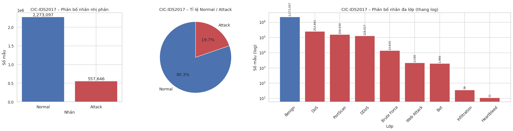
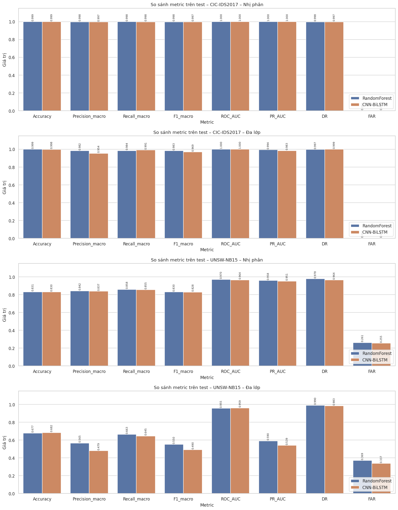
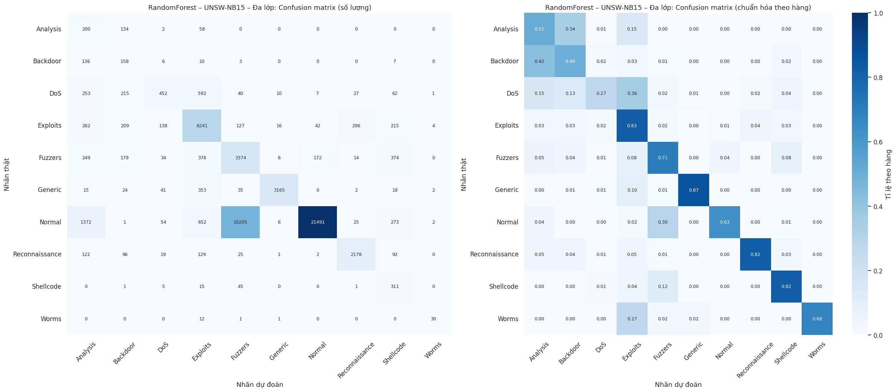

# Hệ thống phát hiện xâm nhập mạng (Network Intrusion Detection System – NIDS)

So sánh **Random Forest** và mạng lai **CNN-BiLSTM** cho bài toán phát hiện xâm nhập mạng trên hai bộ dữ liệu chuẩn **UNSW-NB15** và **CIC-IDS2017**, với quy trình được thiết kế để **tránh rò rỉ dữ liệu** và đánh giá trung thực.

   

---

## Mục lục

- [Tổng quan](#tổng-quan)
- [Bộ dữ liệu](#bộ-dữ-liệu)
- [Quy trình](#quy-trình)
- [Mô hình](#mô-hình)
- [Kết quả](#kết-quả)
- [Phân tích và thảo luận](#phân-tích-và-thảo-luận)
- [Cấu trúc thư mục](#cấu-trúc-thư-mục)
- [Cách chạy](#cách-chạy)
- [Hạn chế và hướng phát triển](#hạn-chế-và-hướng-phát-triển)
- [Tài liệu tham khảo](#tài-liệu-tham-khảo)

## Tổng quan

Đồ án xây dựng một NIDS dựa trên học máy cho hai bài toán:

- **Nhị phân:** phân biệt lưu lượng bình thường (Normal) và tấn công (Attack).
- **Đa lớp:** xác định loại tấn công.

Tổng cộng **8 thí nghiệm** = 2 mô hình × 2 bộ dữ liệu × 2 bài toán, cùng đầu vào và cùng tập test.

**Điểm nổi bật**

- Loại bản ghi trùng lặp **trước** khi chia tập; với UNSW-NB15 loại thêm các bản ghi train trùng với test.
- Toàn bộ bước tiền xử lý chỉ được học trên tập train; sau tiền xử lý, tỉ lệ dòng test trùng train chỉ còn **0,063%** (UNSW-NB15) và **0,294%** (CIC-IDS2017).
- Đánh giá đầy đủ: Accuracy, Precision/Recall/F1 (macro, weighted), Detection Rate, False Alarm Rate, ROC-AUC, PR-AUC, thời gian, kích thước mô hình, kiểm định McNemar, phân tích lỗi và SHAP.

## Bộ dữ liệu

| | UNSW-NB15 | CIC-IDS2017 |
|---|---|---|
| Nguồn | UNSW Canberra, 2015 | Canadian Institute for Cybersecurity, 2017 |
| Số bản ghi sử dụng | 257.673 (train 175.341 + test 82.332) | 2.830.743 (8 tệp MachineLearningCVE) |
| Số đặc trưng | 38 (35 số, 3 phân loại) | 78 (toàn bộ là số) |
| Số lớp đa lớp | 10 (Normal + 9 loại tấn công) | 9 nhóm (gộp từ 15 nhãn gốc) |
| Tỉ lệ Attack | 63,9% | 19,7% |
| Mất cân bằng (lớn nhất / nhỏ nhất) | 534,5 lần | 206.645,2 lần |
| Chia tập | Giữ tập test chính thức; train → 85% train / 15% val | Lấy mẫu phân tầng 50%, chia 70/15/15 |

Nguồn dữ liệu trên Kaggle:

- UNSW-NB15: đầu ra của notebook `khairulislam/unsw-nb15-eda` (`train.csv`, `test.csv`). Phiên bản này đã biến đổi log1p một số đặc trưng và không còn các cột `sbytes`, `dbytes`, `tcprtt`, `is_ftp_login`.
- CIC-IDS2017: phiên bản `MachineLearningCVE` (không chứa Flow ID, IP, Timestamp).

Nhãn CIC-IDS2017 được gộp: các biến thể DoS → `DoS`; FTP-Patator, SSH-Patator → `Brute Force`; ba loại tấn công web → `Web Attack`.

<p align="center">
  
</p>

## Quy trình

```
Dữ liệu CSV → EDA → Làm sạch (inf/NaN, trùng lặp) → Chia tập phân tầng
          → Tiền xử lý (fit chỉ trên train) → Random Forest | CNN-BiLSTM
          → Đánh giá trên test → So sánh, McNemar, phân tích lỗi, SHAP
```

Bộ tiền xử lý `NIDSPreprocessor`:

1. Loại cột hằng số.
2. Loại cột tương quan |r| > 0,95 (chiến lược tham lam).
3. Chuyển inf thành NaN, điền bằng median của train.
4. Biến đổi signed-log: `sign(x) · log(1 + |x|)`.
5. One-Hot cho cột phân loại (giá trị hiếm gom thành `other`).
6. `StandardScaler`.

Kết quả: **51 đặc trưng** (UNSW-NB15) và **45 đặc trưng** (CIC-IDS2017).

| Bước làm sạch | UNSW-NB15 train | UNSW-NB15 test | CIC-IDS2017 |
|---|---:|---:|---:|
| Ban đầu | 175.341 | 82.332 | 2.830.743 |
| Dòng NaN bị loại | 0 | 0 | 2.867 |
| Dòng trùng lặp bị loại | 69.617 | 26.809 | 329.691 |
| Train trùng với test bị loại | 1.765 | – | – |
| Dùng để chia tập | **103.959** | **55.523** | **1.251.586** (sau lấy mẫu 50%) |

## Mô hình

**Random Forest** (scikit-learn)

- Baseline: 200 cây, `max_features='sqrt'`, `min_samples_leaf=2`, `class_weight='balanced'`.
- Tinh chỉnh: `RandomizedSearchCV` (8 tổ hợp, 3-fold, F1-macro) trên tập con khoảng 40.000 mẫu; chọn biến thể có F1-macro trên validation cao hơn.

**CNN-BiLSTM** (TensorFlow/Keras), khoảng 141 nghìn tham số

```
Input (F, 1)
→ Conv1D(64, k=3) → BatchNorm → MaxPool(2)
→ Conv1D(128, k=3) → BatchNorm → MaxPool(2)
→ Bidirectional(LSTM(64))
→ Dense(128, ReLU) → Dropout(0,3)
→ Dense(1, sigmoid) | Dense(K, softmax)
```

- Adam (lr = 1e-3), batch 1.024, tối đa 30 epoch.
- EarlyStopping (patience 5), ReduceLROnPlateau, ModelCheckpoint.
- Trọng số lớp sqrt-balanced (chặn trên 50) để xử lý mất cân bằng mà không làm mất ổn định gradient.

## Kết quả

Kết quả trên tập test (RF = Random Forest, DL = CNN-BiLSTM):

| Dataset – bài toán | Mô hình | Accuracy | F1-macro | DR | FAR | ROC-AUC | PR-AUC |
|---|---|---:|---:|---:|---:|---:|---:|
| CIC – nhị phân | RF | 0,9989 | **0,9981** | 0,9976 | 0,0008 | 0,9999 | 0,9997 |
| CIC – nhị phân | DL | 0,9985 | 0,9974 | 0,9975 | 0,0012 | 1,0000 | 0,9998 |
| CIC – đa lớp | RF | 0,9988 | **0,9832** | 0,9970 | 0,0008 | 1,0000 | 0,9943 |
| CIC – đa lớp | DL | 0,9977 | 0,9694 | 0,9989 | 0,0025 | 1,0000 | 0,9835 |
| UNSW – nhị phân | RF | 0,8310 | **0,8300** | 0,9775 | 0,2612 | 0,9699 | 0,9583 |
| UNSW – nhị phân | DL | 0,8297 | 0,8284 | 0,9639 | 0,2547 | 0,9645 | 0,9511 |
| UNSW – đa lớp | RF | 0,6772 | **0,5500** | 0,9896 | 0,3694 | 0,9554 | 0,5903 |
| UNSW – đa lớp | DL | 0,6824 | 0,4895 | 0,9835 | 0,3366 | 0,9590 | 0,5387 |

Chi phí tính toán:

| | Random Forest | CNN-BiLSTM |
|---|---|---|
| Thời gian huấn luyện | 26,9–460,9 giây | 61,5–549,3 giây |
| Thời gian dự đoán | 5,10–8,07 ms / 1.000 mẫu | 8,49–16,45 ms / 1.000 mẫu |
| Kích thước | 49,9–248,3 MB (pickle) · 14,8–66,9 MB (.joblib) | khoảng 1,7 MB (.keras) |

Kiểm định McNemar: khác biệt có ý nghĩa thống kê (p < 0,05) ở 3/4 bài toán; riêng UNSW-NB15 nhị phân p = 0,21 (không khác biệt).

<p align="center">
  
</p>

## Phân tích và thảo luận

- **Random Forest đạt F1-macro cao nhất ở cả 4 bài toán**, dự đoán nhanh hơn và dễ giải thích hơn; **CNN-BiLSTM nhỏ hơn khoảng 30–150 lần**.
- **CIC-IDS2017 gần như hoàn hảo**, nhưng mô hình dựa nhiều vào `Destination Port` (Gini importance khoảng 0,24 ở bài toán đa lớp) và `Init_Win_bytes`, vốn gắn với môi trường thử nghiệm. Kết quả nên được hiểu là khả năng nhận lại tấn công trong cùng môi trường, không phải hiệu năng trên mạng thật.
- **UNSW-NB15 khó hơn hẳn:** F1-macro trên validation khoảng 0,93 nhưng trên test chỉ 0,83, do tập test chính thức có phân phối khác tập train.
- **Nguồn lỗi chính trên UNSW-NB15:** 10.205 bản ghi Normal (29,94%) bị nhầm thành Fuzzers; Analysis, Backdoor, DoS và Exploits chồng lấn nhau (dữ liệu có 7.220 dòng trùng đặc trưng nhưng khác nhãn).
- **Trên CIC-IDS2017**, lớp khó nhất là Bot (F1 0,868 với RF, 0,752 với DL). Heartbleed và Infiltration chỉ có 1 và 6 mẫu test nên F1 = 1,0 không có ý nghĩa thống kê.

<p align="center">
  
</p>

## Cấu trúc thư mục

```
.
├── nids_unsw_cicids2017.ipynb   # Notebook nguồn (chưa chạy)
├── nids_results/
│   ├── kaggle_trainning.ipynb   # Notebook đã chạy trên Kaggle (kèm output)
│   ├── README.txt               # Tóm tắt cấu hình và bảng metric
│   ├── figures/                 # Biểu đồ EDA, confusion matrix, ROC/PR, learning curve, SHAP
│   ├── results/                 # summary_metrics.csv, per_class_f1_*.csv, mcnemar.csv,
│   │                            # dl_histories.json, config_and_cleaning_log.json
│   └── models/                  # rf_*.joblib, dl_*.keras, preprocessor_*.joblib, label_encoder_*.joblib
│                                # (không đưa lên git vì dung lượng lớn – xem .gitignore)
├── BaoCao_NIDS.docx             # Báo cáo đồ án
└── Slide_NIDS.pptx              # Slide thuyết trình
```

## Cách chạy

Notebook được thiết kế để chạy trên **Kaggle** (GPU, Python 3):

1. Tạo notebook mới trên Kaggle, tải lên `nids_unsw_cicids2017.ipynb`.
2. Thêm dữ liệu đầu vào:
   - UNSW-NB15: đầu ra của notebook `khairulislam/unsw-nb15-eda`.
   - CIC-IDS2017: bộ dữ liệu chứa thư mục `MachineLearningCVE`.
3. Bật accelerator GPU, chọn **Run All**. Notebook tự dò đường dẫn trong `/kaggle/input`.
4. Kết quả được lưu vào `/kaggle/working` và đóng gói thành `nids_results.zip`.

Các tùy chọn chính nằm trong `CONFIG` ở mục 1.2 của notebook, ví dụ:

```python
CONFIG = {
    'DATASETS': ['UNSW-NB15', 'CIC-IDS2017'],  # bỏ bớt tên để chỉ chạy một dataset
    'CIC_SAMPLE_FRAC': 0.5,                    # tỉ lệ lấy mẫu CIC-IDS2017
    'RF_TUNE': True,                           # bật/tắt RandomizedSearchCV
    'DL_EPOCHS': 30,
    'RUN_SHAP': True,
}
```

Tải lại mô hình để dự đoán (cần định nghĩa lại lớp `NIDSPreprocessor` từ mục 4.3 của notebook trước khi load):

```python
import joblib
prep  = joblib.load('nids_results/models/preprocessor_unsw_nb15.joblib')
model = joblib.load('nids_results/models/rf_unsw_nb15_binary.joblib')
proba = model.predict_proba(prep.transform(df_raw))
```

Môi trường đã chạy: pandas 2.3.3, numpy 2.1.3, scikit-learn 1.6.1, TensorFlow 2.21.0, Keras 3.13.2, SEED = 42.

## Hạn chế và hướng phát triển

**Hạn chế**

- Cả hai bộ dữ liệu đều sinh trong môi trường thử nghiệm; mô hình phụ thuộc vào các đặc trưng gắn với môi trường (`Destination Port`, `sttl`).
- Tỉ lệ cảnh báo sai trên UNSW-NB15 còn cao (25–37%).
- Chỉ dùng 50% dữ liệu CIC-IDS2017; ngưỡng quyết định cố định.

**Hướng phát triển**

- Thí nghiệm loại bỏ (ablation) các đặc trưng gắn môi trường; chia CIC-IDS2017 theo thời gian; đánh giá chéo giữa hai bộ dữ liệu.
- Chọn ngưỡng theo chi phí để giảm FAR; mô hình phân cấp.
- Thử XGBoost/LightGBM, tinh chỉnh kiến trúc CNN-BiLSTM.
- Triển khai thời gian thực với bộ trích xuất đặc trưng luồng (CICFlowMeter).

## Tài liệu tham khảo

1. N. Moustafa and J. Slay, "UNSW-NB15: A comprehensive data set for network intrusion detection systems," *MilCIS*, 2015.
2. I. Sharafaldin, A. H. Lashkari, and A. A. Ghorbani, "Toward generating a new intrusion detection dataset and intrusion traffic characterization," *ICISSP*, 2018.
3. L. Breiman, "Random forests," *Machine Learning*, vol. 45, no. 1, pp. 5–32, 2001.
4. S. Hochreiter and J. Schmidhuber, "Long short-term memory," *Neural Computation*, vol. 9, no. 8, pp. 1735–1780, 1997.
5. G. Engelen, V. Rimmer, and W. Joosen, "Troubleshooting an intrusion detection dataset: The CICIDS2017 case study," *IEEE SPW*, 2021.
6. D. Arp *et al.*, "Dos and don'ts of machine learning in computer security," *USENIX Security*, 2022.

Danh sách đầy đủ có trong báo cáo `BaoCao_NIDS.docx`.
