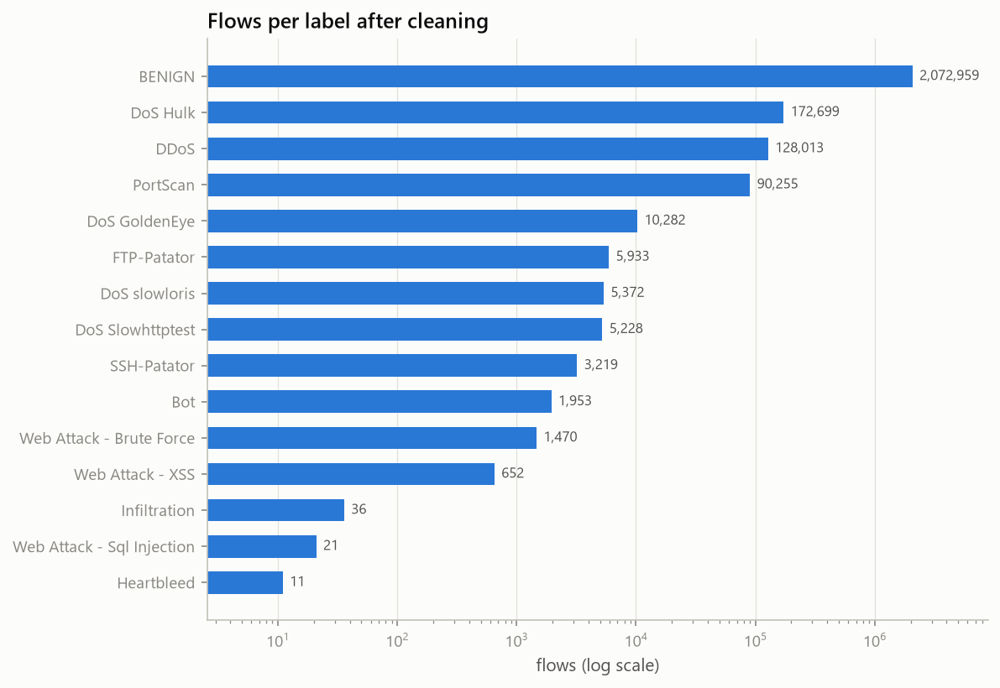
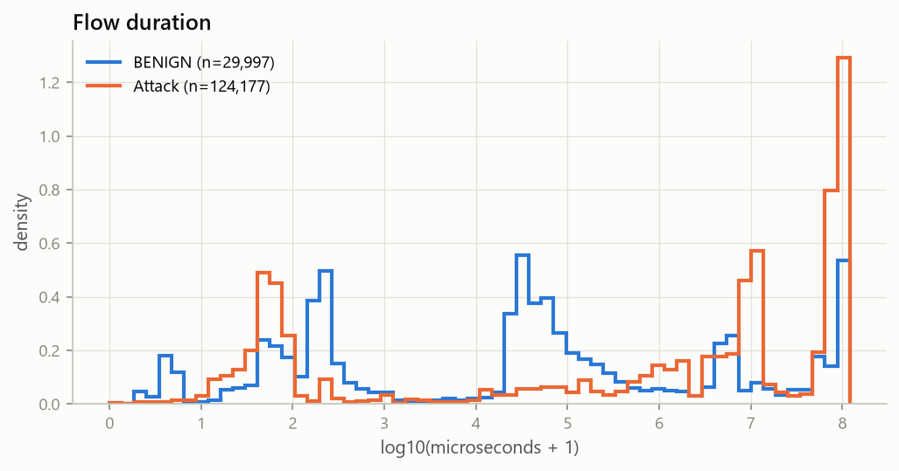
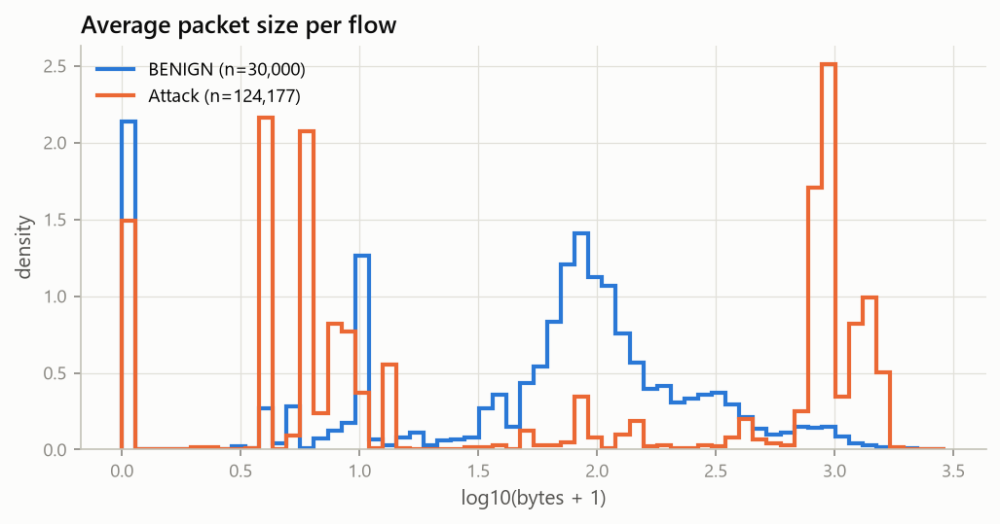
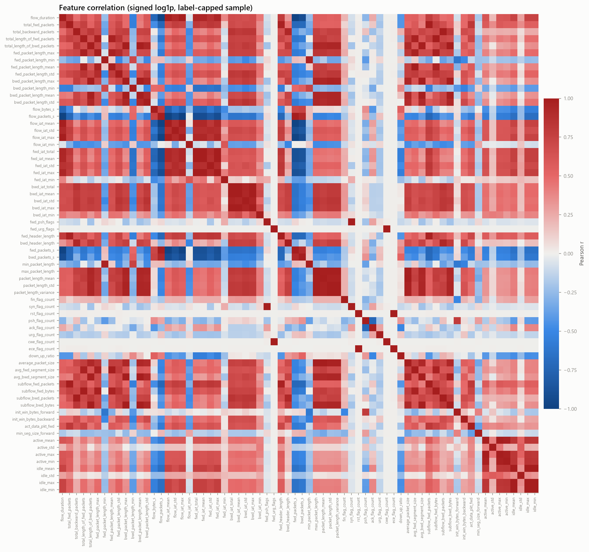
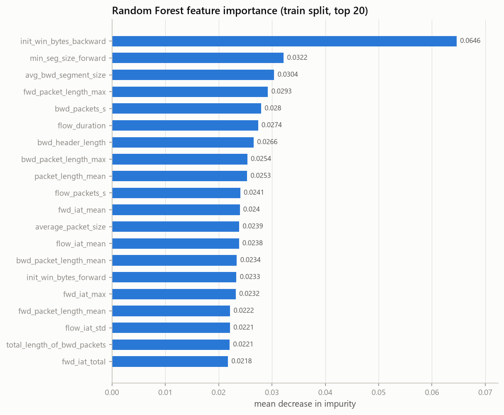

% PHÁT HIỆN XÂM NHẬP MẠNG DỰA TRÊN HỌC MÁY SỬ DỤNG DỮ LIỆU LƯU LƯỢNG MẠNG
% Machine Learning-Based Network Intrusion Detection Using Network Traffic Data
% Báo cáo tiến độ — cập nhật đến STEP 5 (30/10/2026)

<!--
Nguồn của report.docx. Build lại bằng:  node scripts/build_report.js
Cú pháp hỗ trợ: "% " (khối tiêu đề), #/##/### (đề mục), đoạn văn, "- " (gạch đầu dòng, thụt 2 dấu cách
cho cấp 2), "1. " (đánh số), bảng pipe, , **đậm**, *nghiêng*, `code`.
Đoạn bắt đầu bằng "Bảng N." được định dạng thành chú thích bảng.
Quy tắc: chỉ ghi kết quả đã chạy thật; phần chưa làm ghi rõ "chưa thực hiện".
-->

# Tóm tắt

Báo cáo trình bày quá trình xây dựng một hệ thống phát hiện xâm nhập mạng (NIDS) dựa trên học máy, đi từ gói tin thô trong file PCAP đến đặc trưng flow, đặc trưng host và dữ liệu đã sẵn sàng cho huấn luyện. Dữ liệu chính là CIC-IDS-2017 (5 ngày, 52 GB PCAP, 2.830.743 flow có nhãn). Chúng tôi tự xây dựng bộ trích xuất gói tin và flow tương thích với CICFlowMeter để cùng một đoạn mã phục vụ cả phân tích offline lẫn phát hiện thời gian thực. Bộ trích xuất khớp với Scapy trên 100.000 gói tin kiểm thử (0 sai lệch) và tái tạo được 97,85% flow của CIC trong ngày thứ Sáu, với độ phủ 99,996% cho PortScan và 100% cho DDoS và Bot.

Quá trình làm sạch CSV gốc phát hiện 11,70% dòng trùng lặp hoàn toàn, 7.144 dòng trùng đặc trưng nhưng khác nhãn, các cột cờ TCP có dấu hiệu bị đặt sai tên và khoảng 31 nghìn mảnh flow DDoS bị gán nhãn BENIGN. Vì mỗi loại tấn công chỉ xuất hiện trong đúng một ngày, chúng tôi dùng hai cách chia dữ liệu theo thời gian: chia theo lớp cho bài toán phân loại và chia theo ngày cho bài toán phát hiện tấn công chưa từng thấy. Toàn bộ tiền xử lý chỉ được fit trên tập huấn luyện. Phần huấn luyện và đánh giá mô hình (STEP 6–12) chưa được thực hiện tại thời điểm cập nhật này.

**Từ khoá:** phát hiện xâm nhập, học máy, phát hiện bất thường, CIC-IDS-2017, trích xuất flow, rò rỉ dữ liệu.

# 1. Giới thiệu

## 1.1. Bối cảnh

Hệ thống phát hiện xâm nhập dựa trên chữ ký (signature-based) chỉ nhận ra được các tấn công đã biết. Hướng tiếp cận dựa trên học máy học hành vi của lưu lượng mạng ở mức flow, nhờ đó có thể khái quát hoá sang biến thể mới và, với mô hình phát hiện bất thường, cảnh báo cả hành vi chưa từng thấy. Tuy vậy, nhiều công bố trên CIC-IDS-2017 báo cáo độ chính xác trên 99% với cách chia train/test ngẫu nhiên. Cách chia này làm các flow của cùng một đợt tấn công nằm ở cả hai tập, nên kết quả bị thổi phồng và không phản ánh khả năng phát hiện tấn công mới.

## 1.2. Mục tiêu

1. Xây dựng pipeline tái lập được từ PCAP đến đặc trưng flow, dùng chung cho chế độ offline và thời gian thực.
2. Phát hiện bất thường (Gaussian, Isolation Forest, Autoencoder/VAE) chỉ học từ traffic bình thường.
3. Phân loại tấn công có giám sát (Random Forest, XGBoost).
4. Phát hiện botnet bằng đặc trưng đồ thị trên CTU-13.
5. Đánh giá trung thực: chia theo thời gian, đánh giá trên loại tấn công chưa thấy, ablation các đặc trưng phụ thuộc môi trường lab.
6. Triển khai phát hiện thời gian thực trên Kali Linux, mặc định chỉ cảnh báo và không tự động chặn IP.

## 1.3. Phạm vi của bản cập nhật này

Bản này mô tả STEP 1–5: môi trường, khung phần mềm, trích xuất gói tin, tái tạo flow và đặc trưng host, làm sạch dữ liệu, EDA, chia dữ liệu, tiền xử lý và gán nhãn. Các mục 6–8 sẽ được bổ sung khi các bước tương ứng hoàn thành.

# 2. Dữ liệu

## 2.1. CIC-IDS-2017

CIC-IDS-2017 do Canadian Institute for Cybersecurity công bố [1]. Dữ liệu ghi lại 5 ngày làm việc (03–07/07/2017) trên một mạng thử nghiệm có máy nạn nhân và máy tấn công. Bản dùng trong dự án lấy từ mirror HuggingFace `bencorn/CICIDS2017`, gồm:

- 5 file PCAP (52 GB). Dù có đuôi `.pcap`, các file thực chất có định dạng pcapng;
- 8 file CSV trong `MachineLearningCVE` (79 cột) và 8 file trong `TrafficLabelling` (85 cột, thêm IP, cổng và timestamp).

Chúng tôi đã kiểm tra rằng 79 cột đặc trưng của hai bộ CSV trùng khớp từng dòng, nên chỉ dùng `TrafficLabelling` làm nguồn duy nhất. Lý do là bộ này có timestamp, cần cho việc chia dữ liệu theo thời gian.

Bảng 1. Phân bố tấn công theo ngày (sau làm sạch).

| Ngày | Loại tấn công | Tỉ lệ tấn công |
|---|---|---|
| Thứ Hai | Không có (chỉ BENIGN) | 0% |
| Thứ Ba | FTP-Patator, SSH-Patator | 2,21% |
| Thứ Tư | DoS Hulk, GoldenEye, slowloris, Slowhttptest, Heartbleed | 32,6% |
| Thứ Năm | Web Attack (Brute Force, XSS, Sql Injection), Infiltration | 0,55% |
| Thứ Sáu | Bot, PortScan, DDoS | 37,2% |

Các đặc điểm kỹ thuật của CSV mà chúng tôi phải xử lý:

- tên cột có dấu cách ở đầu;
- nhãn Web Attack chứa byte 0x96 (dấu gạch ngang cp1252), còn trong bộ MachineLearningCVE ký tự này bị hỏng thành U+FFFD;
- file Web Attack của thứ Năm có 288.602 dòng trống;
- timestamp là giờ địa phương (UTC−3) theo đồng hồ 12 giờ nhưng **không có AM/PM**, ví dụ `7/7/2017 1:00` nghĩa là 13:00. Vì capture chạy khoảng 08:40–17:10, giờ nhỏ hơn 8 được cộng thêm 12;
- thứ Hai dùng định dạng `dd/mm/YYYY HH:MM:SS`, các ngày khác dùng `d/m/YYYY H:MM`.

## 2.2. CTU-13

CTU-13 [2] gồm 13 kịch bản botnet thật trộn với traffic bình thường và sẽ được dùng ở STEP 9. Tại thời điểm này dữ liệu **chưa được tải**.

# 3. Phương pháp

## 3.1. Kiến trúc tổng thể

Pipeline gồm các khối nối tiếp: đọc PCAP → giải mã header → tái tạo flow hai chiều → đặc trưng flow và đặc trưng host → làm sạch, chia dữ liệu, tiền xử lý → mô hình → cảnh báo. Hai nguyên tắc thiết kế xuyên suốt:

- **Một bộ trích xuất duy nhất.** Chế độ thời gian thực đưa từng gói bắt được (`bytes(packet)`) vào đúng hàm giải mã đã dùng cho PCAP offline. Mô hình vì vậy luôn nhận cùng một schema đặc trưng, tránh lệch giữa huấn luyện và triển khai.
- **Cấu hình tập trung.** Mọi tham số (timeout, cửa sổ, ngưỡng, đường dẫn, cách chia dữ liệu) nằm trong `configs/config.yaml`.

## 3.2. Đọc PCAP và giải mã gói tin

Scapy (`RawPcapReader`) chỉ được dùng để đọc frame thô; nó tự nhận diện pcap hay pcapng. Timestamp được lưu chính xác dưới dạng số nguyên nano giây. Header được giải mã trực tiếp từ byte bằng `struct`:

- tầng liên kết: Ethernet, VLAN 802.1Q, raw IP, Linux SLL/SLL2, BSD loopback;
- tầng mạng: IPv4 và IPv6 (có extension header), phân mảnh IP;
- tầng giao vận: TCP, UDP, ICMP/ICMPv6, kể cả gói TSO có `total_len = 0` và L4 bị cắt cụt.

Độ dài payload được tính từ trường độ dài của IP chứ không từ số byte bắt được, nên padding Ethernet và snaplen không làm sai lệch giá trị. Cách tiếp cận này nhanh khoảng 58 lần so với để Scapy tự phân tích gói (~260 nghìn so với ~4,5 nghìn frame/giây).

## 3.3. Tái tạo flow và đặc trưng flow

Flow được nhóm theo 5-tuple không phân biệt chiều. Máy gửi gói đầu tiên là chiều forward. Ngữ nghĩa bám theo CICFlowMeter để có thể đối chiếu với nhãn của CIC:

- flow timeout 120 s; activity timeout 5 s dùng cho thống kê active/idle;
- đơn vị µs; độ lệch chuẩn mẫu (n−1); kết thúc flow khi có FIN từ cả hai phía, RST, timeout, idle hoặc khi capture kết thúc.

Chúng tôi bổ sung các cơ chế mà CICFlowMeter không có:

- một khoảng chờ `tcp_close_grace_s` = 1 s sau FIN/RST, để các gói ACK cuối không tạo ra flow mới;
- xử lý trường hợp gói trả lời có timestamp sớm hơn gói SYN (`reorder_window_us` = 1 ms);
- giới hạn `max_active_flows` và quét định kỳ để bộ nhớ có giới hạn khi chạy thời gian thực.

Mỗi flow có khoảng 80 đặc trưng: thời lượng; số gói và số byte mỗi chiều; thống kê độ dài gói; inter-arrival time; số cờ TCP; độ dài header; cửa sổ TCP ban đầu; active/idle; tỉ lệ download/upload.

## 3.4. Đặc trưng theo host

Flow được gom theo IP nguồn trong cửa sổ trượt dài 60 s, bước 10 s. Mỗi cửa sổ tính:

- số flow, số IP đích và số cổng đích khác nhau, tốc độ kết nối;
- entropy cổng, trung bình và độ lệch chuẩn khoảng cách giữa các kết nối;
- tỉ lệ SYN/ACK, số kết nối lặp lại, số kết nối thất bại.

Cờ `portscan_suspect` được bật khi có quét dọc (≥ 50 cổng đích) hoặc quét ngang (≥ 20 IP đích và tỉ lệ kết nối TCP thất bại ≥ 0,5). Điều kiện tỉ lệ thất bại được thêm vào sau khi thấy duyệt web qua CDN bị gắn cờ nhầm. Phát hiện beaconing dùng hệ số biến thiên (CV) của khoảng cách giữa các kết nối từ một nguồn tới cùng một đích/cổng/giao thức: ít nhất 6 kết nối và CV ≤ 0,2. Đây là chỉ báo heuristic, không phải bằng chứng tấn công.

## 3.5. Làm sạch dữ liệu CSV của CIC

1. Chuẩn hoá tên cột và nhãn, bỏ dòng trống, chuyển timestamp sang UTC.
2. Ép kiểu số; đếm NaN, ±Inf và giá trị âm theo từng cột; đổi Inf thành NaN.
3. Giá trị âm vô lý (thời lượng, IAT, độ dài header) đổi thành NaN. Riêng `Init_Win_bytes_* = −1` được giữ lại vì đây là giá trị đánh dấu "chiều này không có gói TCP".
4. Bỏ cột `Fwd Header Length.1` vì giống hệt `Fwd Header Length` ở cả 8 file.
5. Bỏ dòng trùng hoàn toàn. Khoá trùng gồm toàn bộ đặc trưng, cổng đích, giao thức và nhãn; không gồm IP, cổng nguồn và timestamp.
6. Bỏ các dòng trùng đặc trưng nhưng khác nhãn, vì nhãn của chúng không thể học được từ đặc trưng.
7. Bỏ các cột hằng; đổi tên cột sang snake_case; lưu đặc trưng ở float32; thêm `label_group` (8 nhóm) và `label_binary`.

## 3.6. Chia dữ liệu

Vì mỗi loại tấn công gắn với đúng một ngày, chia ngẫu nhiên sẽ đưa các flow gần như giống hệt nhau của cùng một đợt tấn công vào cả train và test. Chúng tôi dùng ba chiến lược:

- **`temporal_per_class`** (phân loại có giám sát): trong từng nhãn, 65% flow sớm nhất vào train, 15% kế tiếp vào validation, 20% muộn nhất vào test. Lớp nào có ít nhất 3 flow đều có mặt ở cả ba tập.
- **`by_day`** (phát hiện bất thường, tấn công chưa thấy): train thứ Hai–thứ Tư, test thứ Năm–thứ Sáu. Validation là phần muộn nhất của các ngày train. Bộ tiền xử lý chỉ fit trên traffic BENIGN của train.
- **`stratified_random`**: chỉ làm mốc, để định lượng mức lạc quan của chia ngẫu nhiên.

Việc gán dòng vào tập nào không nhìn vào giá trị đặc trưng.

## 3.7. Tiền xử lý

Pipeline (scikit-learn), **chỉ fit trên tập train**:

- đặc trưng số: điền median → signed log1p, tức sign(x)·log(1+|x|) → RobustScaler;
- `dst_port` và `protocol`: one-hot, giữ 32 cổng phổ biến nhất của tập train, gộp phần còn lại vào nhóm "infrequent";
- loại một đặc trưng trong mỗi cặp có |r| > 0,99. Hệ số tương quan được tính trên mẫu 300.000 dòng của tập train.

Mất cân bằng lớp được xử lý bằng class weight. SMOTE (tối đa 50.000 mẫu mỗi lớp) chỉ áp dụng cho tập train. Bộ tiền xử lý được lưu cùng file schema mô tả cột vào và ra để phần suy luận áp dụng đúng phép biến đổi.

## 3.8. Gán nhãn cho flow tự trích xuất

Flow tự trích từ PCAP được gán nhãn CIC bằng cách khớp 5-tuple không phân biệt chiều và phút bắt đầu, với sai lệch tối đa ±1 phút. Mỗi flow nhận một trong bốn trạng thái:

- `matched`: mọi flow CIC ứng viên có cùng nhãn;
- `conflict_benign_attack`: ứng viên gồm BENIGN và đúng một nhãn tấn công. Nhãn tấn công được dùng, vì đây thường là kết nối mà CIC đã tách làm hai;
- `ambiguous`: có từ hai nhãn tấn công khác nhau trở lên; không gán nhãn;
- `unmatched`: không có ứng viên; không gán nhãn.

Flow không có nhãn bị loại khỏi huấn luyện có giám sát.

# 4. Thực nghiệm và kết quả

## 4.1. Môi trường

Bảng 2. Môi trường thực nghiệm.

| Thành phần | Giá trị |
|---|---|
| Hệ điều hành | Windows 11 Home (phát triển); Kali Linux (triển khai, chưa thực hiện) |
| Python | 3.12.0, môi trường ảo `.venv` |
| Phần cứng | RAM 15,7 GB (khi chạy thường chỉ trống 2,5–3,3 GB), không có GPU |
| Thư viện chính | numpy 2.5.4, pandas 3.1.0, pyarrow 26.0.0, scikit-learn 1.9.1, imbalanced-learn 0.14.2, xgboost 3.4.1, torch 2.15.0 (CPU), scapy 2.8.0, networkx 3.7 |
| Bắt gói | Npcap (Windows) |

## 4.2. Kiểm chứng bộ giải mã gói tin

Kết quả của bộ giải mã `struct` được so từng trường với Scapy trên 100.000 gói thật lấy từ cả 5 file PCAP: **0 sai lệch**. Các trường so sánh gồm IP, cổng, giao thức, độ dài, TTL, cờ TCP, cửa sổ TCP, kiểu/mã ICMP và phân mảnh. Các datagram UDP bị phân mảnh không được so phần độ dài payload UDP, vì Scapy không ghép mảnh.

## 4.3. Tái tạo flow và đối chiếu với CIC

Bảng 3. Kết quả trích xuất flow từ PCAP.

| Ngày | Số gói | Số flow | Thời gian chạy |
|---|---|---|---|
| Thứ Hai | 11.655.546 | 373.077 | 478 s |
| Thứ Ba | 11.499.288 | 323.347 | không ghi nhận |
| Thứ Tư | 13.732.433 | 498.212 | 704 s |
| Thứ Năm | 9.268.753 | 365.887 | 165 s |
| Thứ Sáu | 9.944.187 | 549.191 | không ghi nhận |
| **Tổng** | **56.100.207** | **2.109.714** | |

Đối chiếu trên toàn bộ ngày thứ Sáu (12:00–20:00 UTC) cho thấy:

- **97,85%** flow của CIC tìm được flow tương ứng của chúng tôi, và **99,73%** flow của chúng tôi khớp với CIC;
- theo nhãn: PortScan 99,996%, DDoS 100%, Bot 100%, BENIGN 96,35%;
- với các cặp khớp duy nhất (421.887 cặp), chiều forward trùng nhau ở 97,94%;
- tổng số gói khớp chính xác ở 86,0%; ở 13,9% flow, flow của chúng tôi có nhiều gói hơn.

Hai khác biệt có hệ thống giải thích phần lớn chênh lệch:

1. **CIC tách một kết nối TCP thành hai flow ngay ở FIN đầu tiên.** Phần còn lại (FIN/ACK của phía kia) trở thành một flow riêng. Bộ trích của chúng tôi giữ nguyên kết nối, nên có ít flow hơn (549.191 so với 701.691) và mỗi flow có nhiều gói hơn.
2. **CIC tính cả padding Ethernet vào payload.** Gói nhỏ hơn 60 byte bị cộng thêm khoảng 6 byte, khớp với độ lệch trung vị 6 byte của `bwd_bytes`.

Flow UDP khớp chính xác với CIC.

Khi đối chiếu, chúng tôi cũng thấy giá trị cờ trong CIC không nhất quán: CIC báo SYN = 0 cho các flow mà gói tin rõ ràng có SYN. Mục 4.5 cho thấy điều này có liên quan tới việc các cột cờ bị đặt sai tên.

## 4.4. Đặc trưng host

Với ngày thứ Sáu, máy tấn công PortScan bị gắn cờ `portscan_suspect` ở 88,6% số cửa sổ nằm trong đợt quét (35,1% tính trên mọi cửa sổ có hoạt động của máy này). Các host khác chỉ bị gắn cờ ở 0,05% số cửa sổ.

Trước khi sửa lỗi gói trả lời có timestamp sớm hơn SYN (sớm 1 µs), máy nạn nhân bị gắn cờ nhầm là máy quét ở 119 cửa sổ. Lý do là mỗi gói trả lời lại mở một "flow" mới từ máy nạn nhân. Sau khi sửa, con số này còn 0.

Heuristic beaconing **không phát hiện được** Bot của CIC-IDS-2017. CV của khoảng cách giữa các kết nối là 1,4–1,6; ngay cả khi gom các kết nối thành từng đợt, CV vẫn là 0,54–0,74, cao hơn ngưỡng 0,2. Chúng tôi giữ nguyên ngưỡng thay vì chỉnh cho vừa với dataset, và ghi nhận đây là một hạn chế.

## 4.5. Làm sạch dữ liệu

Bảng 4. Kết quả làm sạch CSV CIC-IDS-2017.

| Hạng mục | Kết quả |
|---|---|
| Dòng đọc vào | 2.830.743 |
| Dòng trùng hoàn toàn bị loại | 331.202 (11,70%) |
| Dòng trùng đặc trưng nhưng khác nhãn bị loại | 7.144 (DoS Hulk 5.317, PortScan 1.053, BENIGN 766, DDoS 6, slowloris 2) |
| Dòng còn lại | 2.498.103 |
| Cột hằng bị loại | 8 (các cột bulk; `fwd/bwd_avg_*_bulk`, `bwd_psh_flags`, `bwd_urg_flags`) |
| Đặc trưng còn lại | 68 đặc trưng số + 2 đặc trưng hạng mục (`dst_port`, `protocol`) |
| Thời gian chạy | 114,1 s |

Giá trị thiếu chỉ xuất hiện ở hai đặc trưng tốc độ, vốn không xác định khi thời lượng bằng 0: `Flow Bytes/s` có 1.358 NaN và 1.509 Inf; `Flow Packets/s` có 2.867 Inf.

Việc loại trùng ảnh hưởng không đều giữa các lớp: PortScan mất 43,2% số dòng, SSH-Patator mất 45,4%, trong khi DDoS, XSS, Infiltration và Heartbleed không mất dòng nào. Như vậy, nếu không loại trùng, hai lớp đầu sẽ có rất nhiều mẫu giống hệt nhau nằm ở cả train và test.

Bảng 5. Số flow theo nhãn sau làm sạch.

| Nhãn | Số flow | Nhãn | Số flow |
|---|---|---|---|
| BENIGN | 2.072.959 | SSH-Patator | 3.219 |
| DoS Hulk | 172.699 | Bot | 1.953 |
| DDoS | 128.013 | Web Attack - Brute Force | 1.470 |
| PortScan | 90.255 | Web Attack - XSS | 652 |
| DoS GoldenEye | 10.282 | Infiltration | 36 |
| FTP-Patator | 5.933 | Web Attack - Sql Injection | 21 |
| DoS slowloris | 5.372 | Heartbleed | 11 |
| DoS Slowhttptest | 5.228 | | |

BENIGN chiếm 82,98%. Tỉ lệ giữa lớp lớn nhất và lớp nhỏ nhất là **188.451 : 1**.

## 4.6. Phân tích khám phá dữ liệu (EDA)

Notebook `eda/data_analysis.ipynb` (33 cell, đã chạy) dùng một mẫu giới hạn tối đa 30.000 flow mỗi nhãn để các lớp nhỏ không bị lấn át. Các phát hiện chính:

- **Thời lượng flow tách biệt rõ giữa các loại tấn công.** PortScan có trung vị 50 µs (99,4% ngắn hơn 1 ms); BENIGN có trung vị 46.323 µs. Ngược lại, slowloris (trung vị 99.999.408 µs), Slowhttptest, DoS Hulk và Heartbleed nằm sát trần timeout 120 s.
- **Kích thước gói.** Trung vị kích thước gói trung bình là 0 byte với Slowhttptest, Web Brute Force và XSS, 3 byte với PortScan, 79 byte với BENIGN, nhưng 918 byte với DoS Hulk, 898 byte với DDoS và 1.620 byte với Heartbleed.
- **Ngoại lai là đặc tính, không phải lỗi.** Theo quy tắc 1,5×IQR, ở đặc trưng trung vị có 17,1% flow BENIGN nằm ngoài ngưỡng, nhưng ở mẫu tấn công chỉ có 3,0%, vì mỗi công cụ tấn công sinh ra các flow rất đồng nhất. Ngoại lai vì vậy không bị loại; signed log1p cùng RobustScaler được dùng thay thế.

**Tương quan.** Có 118 cặp đặc trưng với |r| > 0,9, 63 cặp với |r| > 0,95 và 28 cặp với |r| > 0,99. Nhiều cặp là bản sao chính xác (r = 1,0000), ví dụ mọi cột `subflow_*` bằng cột `total_*` tương ứng. Đáng chú ý, một số cặp cờ không liên quan cũng trùng nhau hoàn toàn: `fwd_psh_flags` = `syn_flag_count`, `rst_flag_count` = `ece_flag_count`, `fwd_urg_flags` = `cwe_flag_count`. Điều này cho thấy các cột cờ trong CSV công bố bị đặt sai tên.

**Mức độ quan trọng của đặc trưng.** Random Forest được huấn luyện trên 102.216 dòng lấy từ tập train của `temporal_per_class`. Đặc trưng xếp hạng cao nhất là `init_win_bytes_backward` (0,0646), cách xa các đặc trưng tiếp theo: `min_seg_size_forward` 0,0322, `avg_bwd_segment_size` 0,0304, `fwd_packet_length_max` 0,0293. `init_win_bytes_backward` là kích thước cửa sổ TCP ban đầu của máy chủ nạn nhân; trung vị của nó là 28.960 với Web Attack nhưng −1 với BENIGN. Đây là đặc điểm của cấu hình lab chứ không phải của tấn công. Cổng đích cũng tập trung theo từng loại tấn công: cổng 80 cho DoS/DDoS/Web, 8080 cho Bot (1.248/1.953), 21/22 cho Patator, 444 cho Heartbleed và Infiltration. Xếp hạng này chỉ mang tính khám phá, vì các đặc trưng tương quan chia nhau mức độ quan trọng.

## 4.7. Kết quả chia dữ liệu

Bảng 6. Kích thước các tập theo từng chiến lược.

| Chiến lược | Train | Validation | Test | Số đặc trưng sau tiền xử lý |
|---|---|---|---|---|
| `temporal_per_class` (fit trên tất cả nhãn) | 1.623.767 | 374.715 | 499.621 | 83 (loại 21 đặc trưng tương quan) |
| `by_day` (fit chỉ trên BENIGN) | 1.228.079 | 283.403 | 986.621 | 82 (loại 22) |
| `stratified_random` | 1.623.766 | 374.716 | 499.621 | 82 (loại 22) |

Với `temporal_per_class`, cả 15 nhãn có mặt ở cả ba tập. Tuy nhiên, các lớp hiếm nhất chỉ có rất ít mẫu test: Heartbleed 7/2/2, Infiltration 24/5/7, Sql Injection 14/3/4 (train/val/test). Chỉ số đánh giá riêng của ba lớp này vì vậy không đủ tin cậy về mặt thống kê.

Với `by_day`:

- train gồm BENIGN và 5 loại tấn công của thứ Ba và thứ Tư;
- validation (cuối ngày thứ Tư) có thêm DoS GoldenEye và Heartbleed, hai loại không có trong train;
- test gồm 764.221 flow BENIGN và **7 loại tấn công hoàn toàn không xuất hiện khi huấn luyện**: DDoS 128.013, PortScan 90.255, Bot 1.953, Web Brute Force 1.470, XSS 652, Infiltration 36, Sql Injection 21.

Đây là thiết lập dùng để đánh giá khả năng phát hiện tấn công chưa thấy. Dù vậy, đây vẫn là dữ liệu của cùng một mạng lab, nên kết quả không tương đương với phát hiện zero-day trong môi trường thật.

## 4.8. Gán nhãn cho flow tự trích xuất

Bảng 7. Trạng thái gán nhãn cho flow tự trích của 5 ngày.

| Ngày | Số flow | matched | conflict_benign_attack | unmatched |
|---|---|---|---|---|
| Thứ Hai | 373.077 | 371.798 | 0 | 1.279 |
| Thứ Ba | 323.347 | 320.519 | 1.599 | 1.229 |
| Thứ Tư | 498.212 | 487.002 | 10.263 | 947 |
| Thứ Năm | 365.887 | 363.095 | 1.834 | 958 |
| Thứ Sáu | 549.191 | 513.342 | 34.382 | 1.467 |
| **Tổng** | **2.109.714** | **2.055.756** | **48.078** | **5.880 (0,28%)** |

Không có flow nào ở trạng thái `ambiguous`, và đủ cả 15 nhãn được tái tạo. Phần lớn xung đột của thứ Sáu là flow DDoS. Nguyên nhân: những mảnh flow mà CIC ghi máy nạn nhân là nguồn (phần "đuôi" sau khi CIC tách kết nối ở FIN) bị gán nhãn BENIGN. Có 31.286 dòng như vậy trong CSV của thứ Sáu. Bộ gán nhãn của chúng tôi gán đúng các flow này là DDoS. Tuy vậy, mô hình huấn luyện trên CSV gốc của CIC vẫn kế thừa lỗi nhãn này; chúng tôi không tự sửa nhãn của CIC.

## 4.9. Kiểm thử phần mềm

79 test pytest đều đạt. Phạm vi test gồm: cấu hình, kiểm tra dataset, CLI, giải mã gói tin (kể cả file cắt cụt, IPv6, phân mảnh, VLAN), tái tạo flow (timeout, FIN/RST, gói đến lệch thứ tự, active/idle), đặc trưng host, đọc CSV CIC, làm sạch và tiền xử lý (không rò rỉ dữ liệu, xử lý giá trị đánh dấu −1).

# 5. Thảo luận

## 5.1. Chất lượng nhãn của CIC-IDS-2017

Kết quả ở mục 4.3–4.8 xác nhận và định lượng một số vấn đề đã được cộng đồng nhắc tới về CIC-IDS-2017:

- cách tách flow ở FIN đầu tiên;
- padding Ethernet bị tính vào payload;
- các cột cờ bị đặt sai tên;
- các mảnh DDoS bị gán nhãn BENIGN;
- 11,7% dòng trùng lặp.

Những lỗi này ảnh hưởng trực tiếp đến cả huấn luyện và đánh giá. Ví dụ, một mô hình "phát hiện" đúng các mảnh DDoS kia sẽ bị tính là báo động sai. Chúng tôi ghi nhận các lỗi và giữ nguyên nhãn gốc khi dùng benchmark CSV, để kết quả còn so sánh được với các công trình khác. Bên cạnh đó, chúng tôi có thêm bộ flow tự trích với nhãn nhất quán hơn để đối chiếu.

## 5.2. Rủi ro học "lối tắt" từ môi trường lab

Đặc trưng mạnh nhất trong EDA (`init_win_bytes_backward`) và cổng đích phản ánh cấu hình cụ thể của máy nạn nhân trong lab. Một mô hình dựa vào chúng có thể đạt điểm cao trên CIC-IDS-2017 nhưng không khái quát được sang mạng khác. STEP 10 sẽ đo mức phụ thuộc này bằng ablation, tức huấn luyện lại sau khi bỏ các đặc trưng đó.

## 5.3. Thiết kế đánh giá

Việc dùng song song ba cách chia dữ liệu cho phép tách bạch ba câu hỏi:

- mô hình phân loại tốt đến đâu trên các tấn công **đã biết**, khi dữ liệu test nằm sau dữ liệu train về thời gian;
- mô hình phát hiện bất thường có nhận ra tấn công **chưa thấy** không;
- chia ngẫu nhiên thổi phồng kết quả bao nhiêu.

# 6. Hạn chế

1. Ba lớp hiếm nhất chỉ có 2–7 flow trong tập test, nên chỉ số đánh giá riêng của chúng không đáng tin cậy. Khi báo cáo cần kèm macro-F1 và kết quả theo nhóm tấn công (`label_group`).
2. Nhãn CIC có lỗi đã nêu ở mục 5.1, và mô hình trên benchmark CSV kế thừa các lỗi này.
3. Heuristic beaconing chưa phát hiện được Bot; ngưỡng của các cờ nghi ngờ chưa được hiệu chỉnh.
4. Đặc trưng host mới được tính cho ngày thứ Sáu.
5. Tài nguyên hạn chế (RAM trống 2,5–3,3 GB, không GPU) có thể buộc phải lấy mẫu khi huấn luyện mô hình lớn.
6. CTU-13 chưa được tải; phần botnet bằng đồ thị chưa có dữ liệu.

# 7. Kế hoạch các bước tiếp theo

Các mục dưới đây **chưa thực hiện**. Kết quả sẽ được ghi vào báo cáo khi từng bước hoàn thành.

- **STEP 6 — Phát hiện bất thường:** mô hình Gaussian (log-likelihood, chỉ học BENIGN) và Isolation Forest, trên cách chia `by_day`. Ngưỡng được chọn trên tập validation. Chỉ số đánh giá: Precision, Recall, F1, ROC-AUC, PR-AUC, FPR, độ trễ.
- **STEP 7 — Phân loại có giám sát:** Random Forest và XGBoost trên `temporal_per_class`; so sánh class weight với SMOTE; báo cáo macro-F1 và ma trận nhầm lẫn.
- **STEP 8 — Deep learning:** Autoencoder và VAE, dùng lỗi tái tạo làm điểm bất thường.
- **STEP 9 — Botnet bằng đồ thị:** dựng đồ thị host–host từ CTU-13 và trích đặc trưng đồ thị (bậc, PageRank, hệ số phân cụm…). Chỉ kết luận về cấu trúc tập trung hay P2P nếu dữ liệu và thực nghiệm cho phép.
- **STEP 10 — So sánh và ablation:** so sánh các mô hình; đo khoảng cách giữa chia ngẫu nhiên và chia theo thời gian; ablation các đặc trưng phụ thuộc lab.
- **STEP 11 — Thời gian thực:** bắt gói trên Kali bằng chung bộ trích xuất, ghi cảnh báo dạng JSONL, mặc định không chặn IP, chỉ thử trên mạng lab cô lập.
- **STEP 12 — Hoàn thiện:** kiểm thử tổng thể, tài liệu và báo cáo cuối.

# 8. Kết luận (tạm thời)

Đến STEP 5, dự án đã có một pipeline tái lập được từ PCAP tới dữ liệu sẵn sàng cho huấn luyện. Bộ trích xuất flow được kiểm chứng định lượng với Scapy và với CIC. Ba cách chia dữ liệu đều tránh rò rỉ thông tin từ tập test. Kết quả quan trọng nhất của giai đoạn này là hiểu rõ và định lượng được chất lượng dữ liệu: trùng lặp, lỗi nhãn, cột bị đặt sai tên và các đặc trưng phụ thuộc lab. Những yếu tố này sẽ quyết định cách diễn giải mọi kết quả mô hình ở các bước sau.

# Tài liệu tham khảo

[1] I. Sharafaldin, A. H. Lashkari, A. A. Ghorbani, "Toward Generating a New Intrusion Detection Dataset and Intrusion Traffic Characterization," in *Proc. 4th Int. Conf. on Information Systems Security and Privacy (ICISSP)*, 2018, pp. 108–116.

[2] S. García, M. Grill, J. Stiborek, A. Zunino, "An empirical comparison of botnet detection methods," *Computers & Security*, vol. 45, pp. 100–123, 2014.

[3] A. H. Lashkari, G. Draper-Gil, M. S. I. Mamun, A. A. Ghorbani, "Characterization of Tor Traffic using Time based Features," in *Proc. ICISSP*, 2017. (CICFlowMeter)

[4] F. T. Liu, K. M. Ting, Z.-H. Zhou, "Isolation Forest," in *Proc. IEEE ICDM*, 2008, pp. 413–422.

[5] F. Pedregosa et al., "Scikit-learn: Machine Learning in Python," *Journal of Machine Learning Research*, vol. 12, pp. 2825–2830, 2011.
