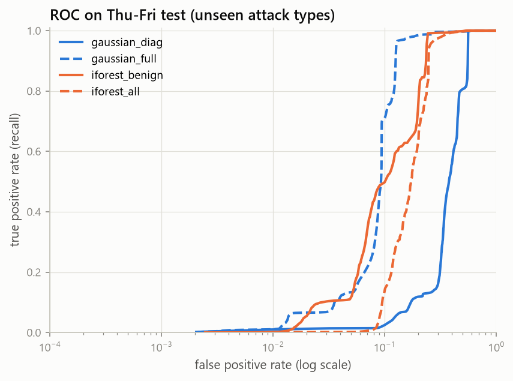
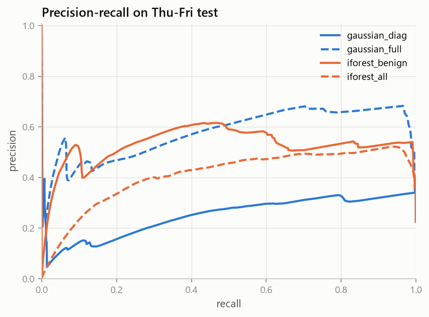
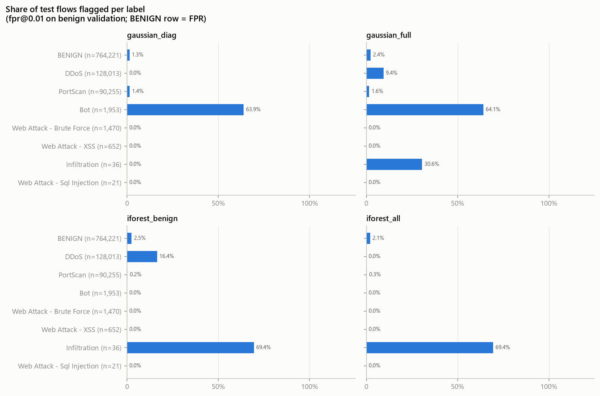
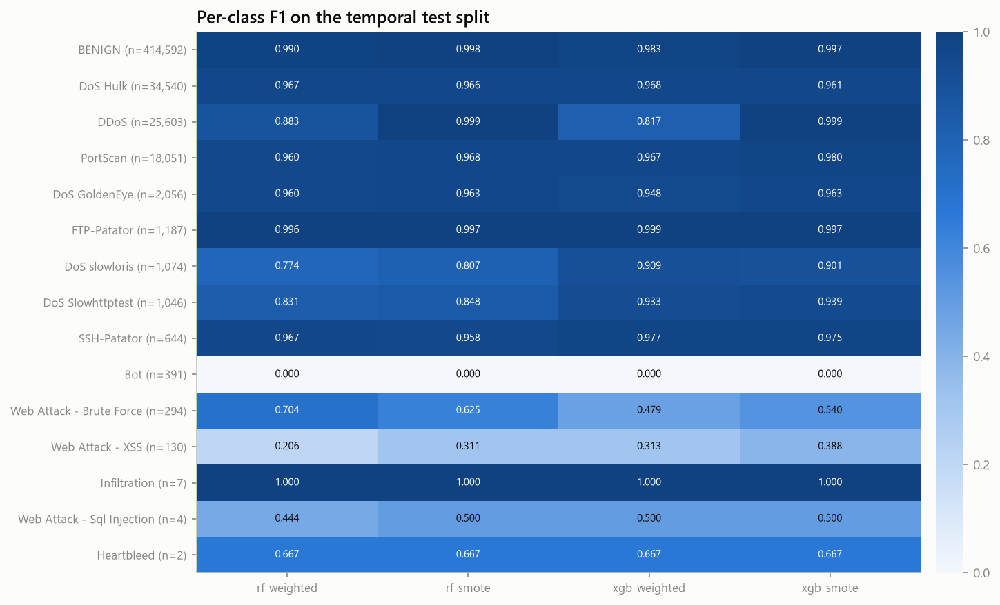
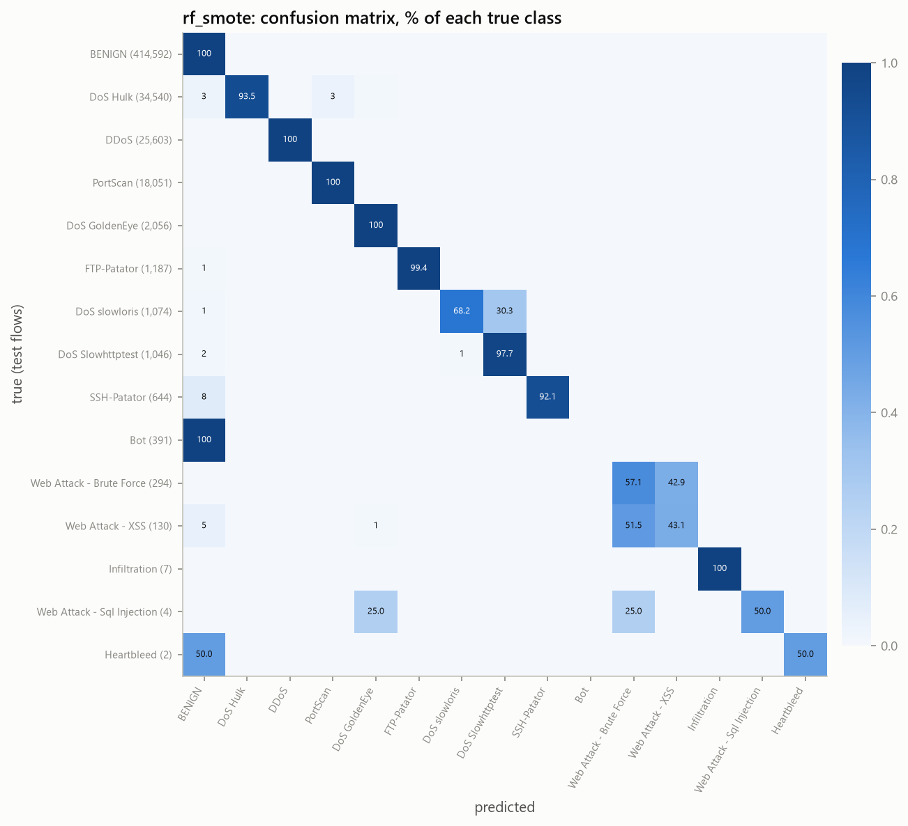
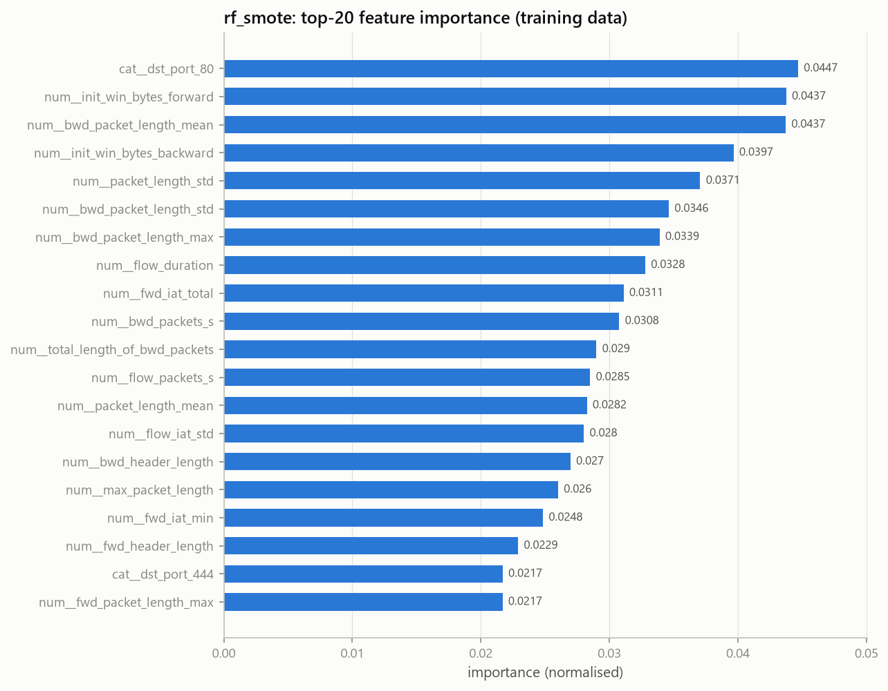
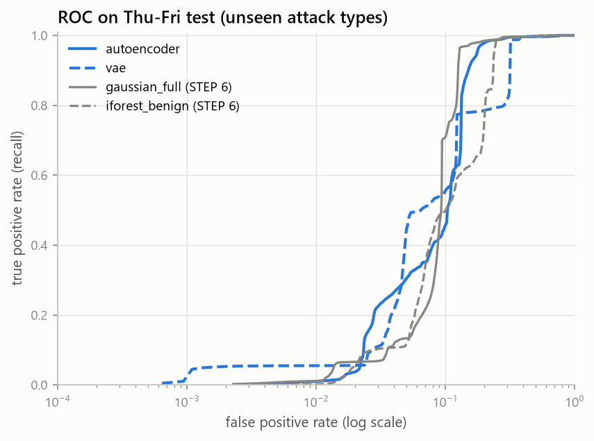
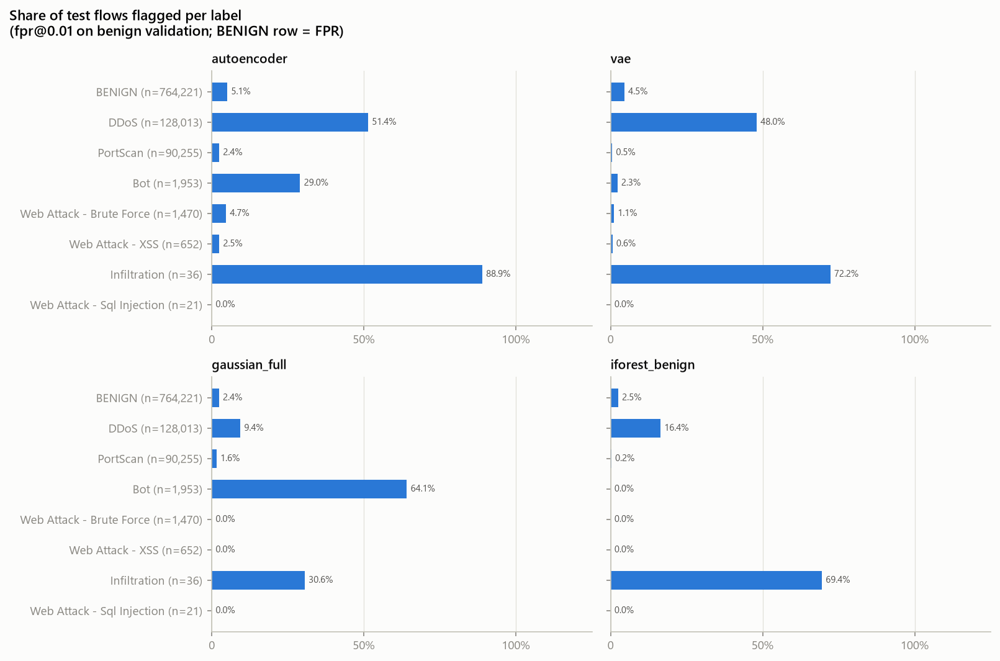

% PHÁT HIỆN XÂM NHẬP MẠNG DỰA TRÊN HỌC MÁY SỬ DỤNG DỮ LIỆU LƯU LƯỢNG MẠNG
% Machine Learning-Based Network Intrusion Detection Using Network Traffic Data
% Báo cáo tiến độ — cập nhật đến STEP 8 (11/11/2026)

<!--
Nguồn của report.docx. Build lại bằng:  node scripts/build_report.js
Cú pháp hỗ trợ: "% " (khối tiêu đề), #/##/### (đề mục), đoạn văn, "- " (gạch đầu dòng, thụt 2 dấu cách
cho cấp 2), "1. " (đánh số), bảng pipe, , **đậm**, *nghiêng*, `code`.
Đoạn bắt đầu bằng "Bảng N." được định dạng thành chú thích bảng.
Quy tắc: chỉ ghi kết quả đã chạy thật trên dữ liệu thật; phần chưa làm ghi rõ "chưa thực hiện";
kết quả trên dữ liệu tổng hợp chỉ được ghi là kiểm thử chức năng.
-->

# Tóm tắt

Báo cáo trình bày quá trình xây dựng một hệ thống phát hiện xâm nhập mạng (NIDS) dựa trên học máy, đi từ gói tin thô trong file PCAP đến đặc trưng flow, đặc trưng host, dữ liệu huấn luyện chống rò rỉ và các mô hình phát hiện bất thường. Dữ liệu chính là CIC-IDS-2017 (5 ngày, 52 GB PCAP, 2.830.743 flow có nhãn). Bộ trích xuất gói tin và flow tương thích với CICFlowMeter khớp 100% với Scapy trên 100.000 gói tin kiểm thử và tái tạo được 97,85% flow của CIC trong ngày thứ Sáu.

Ở STEP 6, mô hình Gaussian (đường chéo và hiệp phương sai đầy đủ) và Isolation Forest được huấn luyện chỉ trên traffic thứ Hai–thứ Tư và đánh giá trên thứ Năm–thứ Sáu, nơi cả 7 loại tấn công đều chưa từng xuất hiện khi huấn luyện. Mô hình tốt nhất (Gaussian hiệp phương sai đầy đủ) đạt ROC-AUC 0,909 và PR-AUC 0,576. Tuy vậy, với ngưỡng hiệu chỉnh để báo động sai trên benign của validation là 1%, recall trên test chỉ 6,6–9,6%: Bot và Infiltration được phát hiện một phần, còn Web Attack và PortScan gần như bị bỏ sót. Phân tích báo động sai cho thấy 45–59% số báo động sai trên test rơi vào đợt DDoS, nơi CIC gán nhầm các mảnh flow DDoS là BENIGN. Ở STEP 7, Random Forest và XGBoost được huấn luyện trên 65% flow sớm nhất của mỗi nhãn và kiểm tra trên 20% muộn nhất. Mô hình chọn theo validation (Random Forest + SMOTE) đạt macro-F1 0,774 trên 15 nhãn và 0,835 trên 8 nhóm tấn công. DoS, DDoS, PortScan và Brute Force đạt F1 ≥ 0,96, nhưng Bot có F1 bằng 0, vì flow Bot trong test giống hệt các flow tới cùng máy C2 mà CIC gán nhãn BENIGN. Ở STEP 8, Autoencoder và VAE học từ benign trên cùng thiết lập với STEP 6 đạt recall 28–31% ở cùng ngưỡng FPR 1% (gấp ba lần STEP 6), chủ yếu nhờ phát hiện khoảng một nửa số flow DDoS. Các con số của STEP 7–12 trong phiên bản báo cáo ngày 06/11 được tính trên dữ liệu tổng hợp nên đã bị loại; STEP 9–12 sẽ được đánh giá lại trên dữ liệu thật.

**Từ khoá:** phát hiện xâm nhập, học máy, phát hiện bất thường, CIC-IDS-2017, trích xuất flow, rò rỉ dữ liệu.

# 1. Giới thiệu

## 1.1. Bối cảnh

Hệ thống phát hiện xâm nhập dựa trên chữ ký (signature-based) chỉ nhận ra được các tấn công đã biết. Hướng tiếp cận dựa trên học máy học hành vi của lưu lượng mạng ở mức flow, nhờ đó có thể khái quát hoá sang biến thể mới và, với mô hình phát hiện bất thường, cảnh báo cả hành vi chưa từng thấy. Tuy vậy, nhiều công bố trên CIC-IDS-2017 báo cáo độ chính xác trên 99% với cách chia train/test ngẫu nhiên. Cách chia này làm các flow của cùng một đợt tấn công nằm ở cả hai tập, nên kết quả bị thổi phồng và không phản ánh khả năng phát hiện tấn công mới.

## 1.2. Mục tiêu

1. Xây dựng pipeline tái lập được từ PCAP đến đặc trưng flow, dùng chung cho chế độ offline và thời gian thực.
2. Phát hiện bất thường (Gaussian, Isolation Forest, Autoencoder/VAE) chỉ học từ traffic bình thường.
3. Phân loại tấn công có giám sát (Random Forest, XGBoost).
4. Phát hiện botnet bằng đặc trưng đồ thị trên CTU-13.
5. Đánh giá trung thực: chia theo thời gian, đánh giá trên loại tấn công chưa thấy, ablation các đặc trưng phụ thuộc môi trường lab.
6. Triển khai phát hiện thời gian thực trên Kali Linux, mặc định chỉ cảnh báo và không tự động chặn IP.

## 1.3. Phạm vi của bản cập nhật này

Bản này mô tả STEP 1–8: môi trường, khung phần mềm, trích xuất gói tin, tái tạo flow và đặc trưng host, làm sạch dữ liệu, EDA, chia dữ liệu, tiền xử lý, gán nhãn (mục 2–6) và phát hiện bất thường (mục 7), phân loại có giám sát (mục 8) và phát hiện bất thường bằng học sâu (mục 9). Mục 10 ghi lại các module của STEP 9–12 đã có code nhưng chưa được đánh giá trên dữ liệu thật.

# 2. Dữ liệu

## 2.1. CIC-IDS-2017

CIC-IDS-2017 do Canadian Institute for Cybersecurity công bố [1]. Dữ liệu ghi lại 5 ngày làm việc (03–07/07/2017) trên một mạng thử nghiệm có máy nạn nhân và máy tấn công. Bản dùng trong dự án lấy từ mirror HuggingFace `bencorn/CICIDS2017`, gồm:

- 5 file PCAP (52 GB). Dù có đuôi `.pcap`, các file thực chất có định dạng pcapng;
- 8 file CSV trong `MachineLearningCVE` (79 cột) và 8 file trong `TrafficLabelling` (85 cột, thêm IP, cổng và timestamp).

Chúng tôi đã kiểm tra rằng 79 cột đặc trưng của hai bộ CSV trùng khớp từng dòng, nên chỉ dùng `TrafficLabelling` làm nguồn duy nhất. Lý do là bộ này có timestamp, cần cho việc chia dữ liệu theo thời gian.

Bảng 1. Phân bố tấn công theo ngày (sau làm sạch).

| Ngày | Loại tấn công | Tỉ lệ tấn công |
|---|---|---|
| Thứ Hai | Không có (chỉ BENIGN) | 0% |
| Thứ Ba | FTP-Patator, SSH-Patator | 2,21% |
| Thứ Tư | DoS Hulk, GoldenEye, slowloris, Slowhttptest, Heartbleed | 32,6% |
| Thứ Năm | Web Attack (Brute Force, XSS, Sql Injection), Infiltration | 0,55% |
| Thứ Sáu | Bot, PortScan, DDoS | 37,2% |

Các đặc điểm kỹ thuật của CSV mà chúng tôi phải xử lý:

- tên cột có dấu cách ở đầu;
- nhãn Web Attack chứa byte 0x96 (dấu gạch ngang cp1252), còn trong bộ MachineLearningCVE ký tự này bị hỏng thành U+FFFD;
- file Web Attack của thứ Năm có 288.602 dòng trống;
- timestamp là giờ địa phương (UTC−3) theo đồng hồ 12 giờ nhưng **không có AM/PM**, ví dụ `7/7/2017 1:00` nghĩa là 13:00. Vì capture chạy khoảng 08:40–17:10, giờ nhỏ hơn 8 được cộng thêm 12;
- thứ Hai dùng định dạng `dd/mm/YYYY HH:MM:SS`, các ngày khác dùng `d/m/YYYY H:MM`.

## 2.2. CTU-13

CTU-13 [2] gồm 13 kịch bản botnet thật trộn với traffic bình thường và sẽ được dùng ở STEP 9. Tại thời điểm này dữ liệu **chưa được tải**.

# 3. Phương pháp

## 3.1. Kiến trúc tổng thể

Pipeline gồm các khối nối tiếp: đọc PCAP → giải mã header → tái tạo flow hai chiều → đặc trưng flow và đặc trưng host → làm sạch, chia dữ liệu, tiền xử lý → mô hình → cảnh báo. Hai nguyên tắc thiết kế xuyên suốt:

- **Một bộ trích xuất duy nhất.** Chế độ thời gian thực đưa từng gói bắt được (`bytes(packet)`) vào đúng hàm giải mã đã dùng cho PCAP offline. Mô hình vì vậy luôn nhận cùng một schema đặc trưng, tránh lệch giữa huấn luyện và triển khai.
- **Cấu hình tập trung.** Mọi tham số (timeout, cửa sổ, ngưỡng, đường dẫn, cách chia dữ liệu) nằm trong `configs/config.yaml`.

## 3.2. Đọc PCAP và giải mã gói tin

Scapy (`RawPcapReader`) chỉ được dùng để đọc frame thô; nó tự nhận diện pcap hay pcapng. Timestamp được lưu chính xác dưới dạng số nguyên nano giây. Header được giải mã trực tiếp từ byte bằng `struct`:

- tầng liên kết: Ethernet, VLAN 802.1Q, raw IP, Linux SLL/SLL2, BSD loopback;
- tầng mạng: IPv4 và IPv6 (có extension header), phân mảnh IP;
- tầng giao vận: TCP, UDP, ICMP/ICMPv6, kể cả gói TSO có `total_len = 0` và L4 bị cắt cụt.

Độ dài payload được tính từ trường độ dài của IP chứ không từ số byte bắt được, nên padding Ethernet và snaplen không làm sai lệch giá trị. Cách tiếp cận này nhanh khoảng 58 lần so với để Scapy tự phân tích gói (~260 nghìn so với ~4,5 nghìn frame/giây).

## 3.3. Tái tạo flow và đặc trưng flow

Flow được nhóm theo 5-tuple không phân biệt chiều. Máy gửi gói đầu tiên là chiều forward. Ngữ nghĩa bám theo CICFlowMeter để có thể đối chiếu với nhãn của CIC:

- flow timeout 120 s; activity timeout 5 s dùng cho thống kê active/idle;
- đơn vị µs; độ lệch chuẩn mẫu (n−1); kết thúc flow khi có FIN từ cả hai phía, RST, timeout, idle hoặc khi capture kết thúc.

Chúng tôi bổ sung các cơ chế mà CICFlowMeter không có:

- một khoảng chờ `tcp_close_grace_s` = 1 s sau FIN/RST, để các gói ACK cuối không tạo ra flow mới;
- xử lý trường hợp gói trả lời có timestamp sớm hơn gói SYN (`reorder_window_us` = 1 ms);
- giới hạn `max_active_flows` và quét định kỳ để bộ nhớ có giới hạn khi chạy thời gian thực.

Mỗi flow có khoảng 80 đặc trưng: thời lượng; số gói và số byte mỗi chiều; thống kê độ dài gói; inter-arrival time; số cờ TCP; độ dài header; cửa sổ TCP ban đầu; active/idle; tỉ lệ download/upload.

## 3.4. Đặc trưng theo host

Flow được gom theo IP nguồn trong cửa sổ trượt dài 60 s, bước 10 s. Mỗi cửa sổ tính:

- số flow, số IP đích và số cổng đích khác nhau, tốc độ kết nối;
- entropy cổng, trung bình và độ lệch chuẩn khoảng cách giữa các kết nối;
- tỉ lệ SYN/ACK, số kết nối lặp lại, số kết nối thất bại.

Cờ `portscan_suspect` được bật khi có quét dọc (≥ 50 cổng đích) hoặc quét ngang (≥ 20 IP đích và tỉ lệ kết nối TCP thất bại ≥ 0,5). Điều kiện tỉ lệ thất bại được thêm vào sau khi thấy duyệt web qua CDN bị gắn cờ nhầm. Phát hiện beaconing dùng hệ số biến thiên (CV) của khoảng cách giữa các kết nối từ một nguồn tới cùng một đích/cổng/giao thức: ít nhất 6 kết nối và CV ≤ 0,2. Đây là chỉ báo heuristic, không phải bằng chứng tấn công.

## 3.5. Làm sạch dữ liệu CSV của CIC

1. Chuẩn hoá tên cột và nhãn, bỏ dòng trống, chuyển timestamp sang UTC.
2. Ép kiểu số; đếm NaN, ±Inf và giá trị âm theo từng cột; đổi Inf thành NaN.
3. Giá trị âm vô lý (thời lượng, IAT, độ dài header) đổi thành NaN. Riêng `Init_Win_bytes_* = −1` được giữ lại vì đây là giá trị đánh dấu "chiều này không có gói TCP".
4. Bỏ cột `Fwd Header Length.1` vì giống hệt `Fwd Header Length` ở cả 8 file.
5. Bỏ dòng trùng hoàn toàn. Khoá trùng gồm toàn bộ đặc trưng, cổng đích, giao thức và nhãn; không gồm IP, cổng nguồn và timestamp.
6. Bỏ các dòng trùng đặc trưng nhưng khác nhãn, vì nhãn của chúng không thể học được từ đặc trưng.
7. Bỏ các cột hằng; đổi tên cột sang snake_case; lưu đặc trưng ở float32; thêm `label_group` (8 nhóm) và `label_binary`.

## 3.6. Chia dữ liệu

Vì mỗi loại tấn công gắn với đúng một ngày, chia ngẫu nhiên sẽ đưa các flow gần như giống hệt nhau của cùng một đợt tấn công vào cả train và test. Chúng tôi dùng ba chiến lược:

- **`temporal_per_class`** (phân loại có giám sát): trong từng nhãn, 65% flow sớm nhất vào train, 15% kế tiếp vào validation, 20% muộn nhất vào test. Lớp nào có ít nhất 3 flow đều có mặt ở cả ba tập.
- **`by_day`** (phát hiện bất thường, tấn công chưa thấy): train thứ Hai–thứ Tư, test thứ Năm–thứ Sáu. Validation là phần muộn nhất của các ngày train. Bộ tiền xử lý chỉ fit trên traffic BENIGN của train.
- **`stratified_random`**: chỉ làm mốc, để định lượng mức lạc quan của chia ngẫu nhiên.

Việc gán dòng vào tập nào không nhìn vào giá trị đặc trưng.

## 3.7. Tiền xử lý

Pipeline (scikit-learn), **chỉ fit trên tập train**:

- đặc trưng số: điền median → signed log1p, tức sign(x)·log(1+|x|) → RobustScaler;
- `dst_port` và `protocol`: one-hot, giữ 32 cổng phổ biến nhất của tập train, gộp phần còn lại vào nhóm "infrequent";
- loại một đặc trưng trong mỗi cặp có |r| > 0,99. Hệ số tương quan được tính trên mẫu 300.000 dòng của tập train.

Mất cân bằng lớp được xử lý bằng class weight. SMOTE (tối đa 50.000 mẫu mỗi lớp) chỉ áp dụng cho tập train. Bộ tiền xử lý được lưu cùng file schema mô tả cột vào và ra để phần suy luận áp dụng đúng phép biến đổi.

## 3.8. Gán nhãn cho flow tự trích xuất

Flow tự trích từ PCAP được gán nhãn CIC bằng cách khớp 5-tuple không phân biệt chiều và phút bắt đầu, với sai lệch tối đa ±1 phút. Mỗi flow nhận một trong bốn trạng thái:

- `matched`: mọi flow CIC ứng viên có cùng nhãn;
- `conflict_benign_attack`: ứng viên gồm BENIGN và đúng một nhãn tấn công. Nhãn tấn công được dùng, vì đây thường là kết nối mà CIC đã tách làm hai;
- `ambiguous`: có từ hai nhãn tấn công khác nhau trở lên; không gán nhãn;
- `unmatched`: không có ứng viên; không gán nhãn.

Flow không có nhãn bị loại khỏi huấn luyện có giám sát.

# 4. Thực nghiệm và kết quả

## 4.1. Môi trường

Bảng 2. Môi trường thực nghiệm.

| Thành phần | Giá trị |
|---|---|
| Hệ điều hành | Windows 11 Home (phát triển); Kali Linux (triển khai, chưa thực hiện) |
| Python | 3.12.0, môi trường ảo `.venv` |
| Phần cứng | RAM 15,7 GB (khi chạy thường chỉ trống 2,5–3,3 GB), không có GPU |
| Thư viện chính | numpy 2.5.4, pandas 3.1.0, pyarrow 26.0.0, scikit-learn 1.9.1, imbalanced-learn 0.14.2, xgboost 3.4.1, torch 2.15.0 (CPU), scapy 2.8.0, networkx 3.7 |
| Bắt gói | Npcap (Windows) |

## 4.2. Kiểm chứng bộ giải mã gói tin

Kết quả của bộ giải mã `struct` được so từng trường với Scapy trên 100.000 gói thật lấy từ cả 5 file PCAP: **0 sai lệch**. Các trường so sánh gồm IP, cổng, giao thức, độ dài, TTL, cờ TCP, cửa sổ TCP, kiểu/mã ICMP và phân mảnh. Các datagram UDP bị phân mảnh không được so phần độ dài payload UDP, vì Scapy không ghép mảnh.

## 4.3. Tái tạo flow và đối chiếu với CIC

Bảng 3. Kết quả trích xuất flow từ PCAP.

| Ngày | Số gói | Số flow | Thời gian chạy |
|---|---|---|---|
| Thứ Hai | 11.655.546 | 373.077 | 478 s |
| Thứ Ba | 11.499.288 | 323.347 | không ghi nhận |
| Thứ Tư | 13.732.433 | 498.212 | 704 s |
| Thứ Năm | 9.268.753 | 365.887 | 165 s |
| Thứ Sáu | 9.944.187 | 549.191 | không ghi nhận |
| **Tổng** | **56.100.207** | **2.109.714** | |

Đối chiếu trên toàn bộ ngày thứ Sáu (12:00–20:00 UTC) cho thấy:

- **97,85%** flow của CIC tìm được flow tương ứng của chúng tôi, và **99,73%** flow của chúng tôi khớp với CIC;
- theo nhãn: PortScan 99,996%, DDoS 100%, Bot 100%, BENIGN 96,35%;
- với các cặp khớp duy nhất (421.887 cặp), chiều forward trùng nhau ở 97,94%;
- tổng số gói khớp chính xác ở 86,0%; ở 13,9% flow, flow của chúng tôi có nhiều gói hơn.

Hai khác biệt có hệ thống giải thích phần lớn chênh lệch:

1. **CIC tách một kết nối TCP thành hai flow ngay ở FIN đầu tiên.** Phần còn lại (FIN/ACK của phía kia) trở thành một flow riêng. Bộ trích của chúng tôi giữ nguyên kết nối, nên có ít flow hơn (549.191 so với 701.691) và mỗi flow có nhiều gói hơn.
2. **CIC tính cả padding Ethernet vào payload.** Gói nhỏ hơn 60 byte bị cộng thêm khoảng 6 byte, khớp với độ lệch trung vị 6 byte của `bwd_bytes`.

Flow UDP khớp chính xác với CIC.

Khi đối chiếu, chúng tôi cũng thấy giá trị cờ trong CIC không nhất quán: CIC báo SYN = 0 cho các flow mà gói tin rõ ràng có SYN. Mục 4.5 cho thấy điều này có liên quan tới việc các cột cờ bị đặt sai tên.

## 4.4. Đặc trưng host

Với ngày thứ Sáu, máy tấn công PortScan bị gắn cờ `portscan_suspect` ở 88,6% số cửa sổ nằm trong đợt quét (35,1% tính trên mọi cửa sổ có hoạt động của máy này). Các host khác chỉ bị gắn cờ ở 0,05% số cửa sổ.

Trước khi sửa lỗi gói trả lời có timestamp sớm hơn SYN (sớm 1 µs), máy nạn nhân bị gắn cờ nhầm là máy quét ở 119 cửa sổ. Lý do là mỗi gói trả lời lại mở một "flow" mới từ máy nạn nhân. Sau khi sửa, con số này còn 0.

Heuristic beaconing **không phát hiện được** Bot của CIC-IDS-2017. CV của khoảng cách giữa các kết nối là 1,4–1,6; ngay cả khi gom các kết nối thành từng đợt, CV vẫn là 0,54–0,74, cao hơn ngưỡng 0,2. Chúng tôi giữ nguyên ngưỡng thay vì chỉnh cho vừa với dataset, và ghi nhận đây là một hạn chế.

## 4.5. Làm sạch dữ liệu

Bảng 4. Kết quả làm sạch CSV CIC-IDS-2017.

| Hạng mục | Kết quả |
|---|---|
| Dòng đọc vào | 2.830.743 |
| Dòng trùng hoàn toàn bị loại | 331.202 (11,70%) |
| Dòng trùng đặc trưng nhưng khác nhãn bị loại | 7.144 (DoS Hulk 5.317, PortScan 1.053, BENIGN 766, DDoS 6, slowloris 2) |
| Dòng còn lại | 2.498.103 |
| Cột hằng bị loại | 8 (các cột bulk; `fwd/bwd_avg_*_bulk`, `bwd_psh_flags`, `bwd_urg_flags`) |
| Đặc trưng còn lại | 68 đặc trưng số + 2 đặc trưng hạng mục (`dst_port`, `protocol`) |
| Thời gian chạy | 114,1 s |

Giá trị thiếu chỉ xuất hiện ở hai đặc trưng tốc độ, vốn không xác định khi thời lượng bằng 0: `Flow Bytes/s` có 1.358 NaN và 1.509 Inf; `Flow Packets/s` có 2.867 Inf.

Việc loại trùng ảnh hưởng không đều giữa các lớp: PortScan mất 43,2% số dòng, SSH-Patator mất 45,4%, trong khi DDoS, XSS, Infiltration và Heartbleed không mất dòng nào. Như vậy, nếu không loại trùng, hai lớp đầu sẽ có rất nhiều mẫu giống hệt nhau nằm ở cả train và test.

Bảng 5. Số flow theo nhãn sau làm sạch.

| Nhãn | Số flow | Nhãn | Số flow |
|---|---|---|---|
| BENIGN | 2.072.959 | SSH-Patator | 3.219 |
| DoS Hulk | 172.699 | Bot | 1.953 |
| DDoS | 128.013 | Web Attack - Brute Force | 1.470 |
| PortScan | 90.255 | Web Attack - XSS | 652 |
| DoS GoldenEye | 10.282 | Infiltration | 36 |
| FTP-Patator | 5.933 | Web Attack - Sql Injection | 21 |
| DoS slowloris | 5.372 | Heartbleed | 11 |
| DoS Slowhttptest | 5.228 | | |

BENIGN chiếm 82,98%. Tỉ lệ giữa lớp lớn nhất và lớp nhỏ nhất là **188.451 : 1**.

## 4.6. Phân tích khám phá dữ liệu (EDA)

Notebook `eda/data_analysis.ipynb` (33 cell, đã chạy) dùng một mẫu giới hạn tối đa 30.000 flow mỗi nhãn để các lớp nhỏ không bị lấn át. Các phát hiện chính:

- **Thời lượng flow tách biệt rõ giữa các loại tấn công.** PortScan có trung vị 50 µs (99,4% ngắn hơn 1 ms); BENIGN có trung vị 46.323 µs. Ngược lại, slowloris (trung vị 99.999.408 µs), Slowhttptest, DoS Hulk và Heartbleed nằm sát trần timeout 120 s.
- **Kích thước gói.** Trung vị kích thước gói trung bình là 0 byte với Slowhttptest, Web Brute Force và XSS, 3 byte với PortScan, 79 byte với BENIGN, nhưng 918 byte với DoS Hulk, 898 byte với DDoS và 1.620 byte với Heartbleed.
- **Ngoại lai là đặc tính, không phải lỗi.** Theo quy tắc 1,5×IQR, ở đặc trưng trung vị có 17,1% flow BENIGN nằm ngoài ngưỡng, nhưng ở mẫu tấn công chỉ có 3,0%, vì mỗi công cụ tấn công sinh ra các flow rất đồng nhất. Ngoại lai vì vậy không bị loại; signed log1p cùng RobustScaler được dùng thay thế.

**Tương quan.** Có 118 cặp đặc trưng với |r| > 0,9, 63 cặp với |r| > 0,95 và 28 cặp với |r| > 0,99. Nhiều cặp là bản sao chính xác (r = 1,0000), ví dụ mọi cột `subflow_*` bằng cột `total_*` tương ứng. Đáng chú ý, một số cặp cờ không liên quan cũng trùng nhau hoàn toàn: `fwd_psh_flags` = `syn_flag_count`, `rst_flag_count` = `ece_flag_count`, `fwd_urg_flags` = `cwe_flag_count`. Điều này cho thấy các cột cờ trong CSV công bố bị đặt sai tên.

**Mức độ quan trọng của đặc trưng.** Random Forest được huấn luyện trên 102.216 dòng lấy từ tập train của `temporal_per_class`. Đặc trưng xếp hạng cao nhất là `init_win_bytes_backward` (0,0646), cách xa các đặc trưng tiếp theo: `min_seg_size_forward` 0,0322, `avg_bwd_segment_size` 0,0304, `fwd_packet_length_max` 0,0293. `init_win_bytes_backward` là kích thước cửa sổ TCP ban đầu của máy chủ nạn nhân; trung vị của nó là 28.960 với Web Attack nhưng −1 với BENIGN. Đây là đặc điểm của cấu hình lab chứ không phải của tấn công. Cổng đích cũng tập trung theo từng loại tấn công: cổng 80 cho DoS/DDoS/Web, 8080 cho Bot (1.248/1.953), 21/22 cho Patator, 444 cho Heartbleed và Infiltration. Xếp hạng này chỉ mang tính khám phá, vì các đặc trưng tương quan chia nhau mức độ quan trọng.

## 4.7. Kết quả chia dữ liệu

Bảng 6. Kích thước các tập theo từng chiến lược.

| Chiến lược | Train | Validation | Test | Số đặc trưng sau tiền xử lý |
|---|---|---|---|---|
| `temporal_per_class` (fit trên tất cả nhãn) | 1.623.767 | 374.715 | 499.621 | 83 (loại 21 đặc trưng tương quan) |
| `by_day` (fit chỉ trên BENIGN) | 1.228.079 | 283.403 | 986.621 | 82 (loại 22) |
| `stratified_random` | 1.623.766 | 374.716 | 499.621 | 82 (loại 22) |

Với `temporal_per_class`, cả 15 nhãn có mặt ở cả ba tập. Tuy nhiên, các lớp hiếm nhất chỉ có rất ít mẫu test: Heartbleed 7/2/2, Infiltration 24/5/7, Sql Injection 14/3/4 (train/val/test). Chỉ số đánh giá riêng của ba lớp này vì vậy không đủ tin cậy về mặt thống kê.

Với `by_day`:

- train gồm BENIGN và 5 loại tấn công của thứ Ba và thứ Tư;
- validation (cuối ngày thứ Tư) có thêm DoS GoldenEye và Heartbleed, hai loại không có trong train;
- test gồm 764.221 flow BENIGN và **7 loại tấn công hoàn toàn không xuất hiện khi huấn luyện**: DDoS 128.013, PortScan 90.255, Bot 1.953, Web Brute Force 1.470, XSS 652, Infiltration 36, Sql Injection 21.

Đây là thiết lập dùng để đánh giá khả năng phát hiện tấn công chưa thấy. Dù vậy, đây vẫn là dữ liệu của cùng một mạng lab, nên kết quả không tương đương với phát hiện zero-day trong môi trường thật.

## 4.8. Gán nhãn cho flow tự trích xuất

Bảng 7. Trạng thái gán nhãn cho flow tự trích của 5 ngày.

| Ngày | Số flow | matched | conflict_benign_attack | unmatched |
|---|---|---|---|---|
| Thứ Hai | 373.077 | 371.798 | 0 | 1.279 |
| Thứ Ba | 323.347 | 320.519 | 1.599 | 1.229 |
| Thứ Tư | 498.212 | 487.002 | 10.263 | 947 |
| Thứ Năm | 365.887 | 363.095 | 1.834 | 958 |
| Thứ Sáu | 549.191 | 513.342 | 34.382 | 1.467 |
| **Tổng** | **2.109.714** | **2.055.756** | **48.078** | **5.880 (0,28%)** |

Không có flow nào ở trạng thái `ambiguous`, và đủ cả 15 nhãn được tái tạo. Phần lớn xung đột của thứ Sáu là flow DDoS. Nguyên nhân: những mảnh flow mà CIC ghi máy nạn nhân là nguồn (phần "đuôi" sau khi CIC tách kết nối ở FIN) bị gán nhãn BENIGN. Có 31.286 dòng như vậy trong CSV của thứ Sáu. Bộ gán nhãn của chúng tôi gán đúng các flow này là DDoS. Tuy vậy, mô hình huấn luyện trên CSV gốc của CIC vẫn kế thừa lỗi nhãn này; chúng tôi không tự sửa nhãn của CIC.

## 4.9. Kiểm thử phần mềm

Tại thời điểm hoàn thành STEP 5, 79 test pytest đều đạt. Phạm vi test gồm: cấu hình, kiểm tra dataset, CLI, giải mã gói tin (kể cả file cắt cụt, IPv6, phân mảnh, VLAN), tái tạo flow (timeout, FIN/RST, gói đến lệch thứ tự, active/idle), đặc trưng host, đọc CSV CIC, làm sạch và tiền xử lý (không rò rỉ dữ liệu, xử lý giá trị đánh dấu −1).

# 5. Thảo luận

## 5.1. Chất lượng nhãn của CIC-IDS-2017

Kết quả ở mục 4.3–4.8 xác nhận và định lượng một số vấn đề đã được cộng đồng nhắc tới về CIC-IDS-2017:

- cách tách flow ở FIN đầu tiên;
- padding Ethernet bị tính vào payload;
- các cột cờ bị đặt sai tên;
- các mảnh DDoS bị gán nhãn BENIGN;
- 11,7% dòng trùng lặp.

Những lỗi này ảnh hưởng trực tiếp đến cả huấn luyện và đánh giá. Ví dụ, một mô hình "phát hiện" đúng các mảnh DDoS kia sẽ bị tính là báo động sai. Chúng tôi ghi nhận các lỗi và giữ nguyên nhãn gốc khi dùng benchmark CSV, để kết quả còn so sánh được với các công trình khác. Bên cạnh đó, chúng tôi có thêm bộ flow tự trích với nhãn nhất quán hơn để đối chiếu.

## 5.2. Rủi ro học "lối tắt" từ môi trường lab

Đặc trưng mạnh nhất trong EDA (`init_win_bytes_backward`) và cổng đích phản ánh cấu hình cụ thể của máy nạn nhân trong lab. Một mô hình dựa vào chúng có thể đạt điểm cao trên CIC-IDS-2017 nhưng không khái quát được sang mạng khác. STEP 10 sẽ đo mức phụ thuộc này bằng ablation, tức huấn luyện lại sau khi bỏ các đặc trưng đó.

## 5.3. Thiết kế đánh giá

Việc dùng song song ba cách chia dữ liệu cho phép tách bạch ba câu hỏi:

- mô hình phân loại tốt đến đâu trên các tấn công **đã biết**, khi dữ liệu test nằm sau dữ liệu train về thời gian;
- mô hình phát hiện bất thường có nhận ra tấn công **chưa thấy** không;
- chia ngẫu nhiên thổi phồng kết quả bao nhiêu.

# 6. Hạn chế

1. Ba lớp hiếm nhất chỉ có 2–7 flow trong tập test, nên chỉ số đánh giá riêng của chúng không đáng tin cậy. Khi báo cáo cần kèm macro-F1 và kết quả theo nhóm tấn công (`label_group`).
2. Nhãn CIC có lỗi đã nêu ở mục 5.1, và mô hình trên benchmark CSV kế thừa các lỗi này.
3. Heuristic beaconing chưa phát hiện được Bot; ngưỡng của các cờ nghi ngờ chưa được hiệu chỉnh.
4. Đặc trưng host mới được tính cho ngày thứ Sáu.
5. Tài nguyên hạn chế (RAM trống 2,5–3,3 GB, không GPU) có thể buộc phải lấy mẫu khi huấn luyện mô hình lớn.
6. CTU-13 chưa được tải; phần botnet bằng đồ thị chưa có dữ liệu.
7. STEP 6 chỉ dùng đặc trưng mức flow; các tấn công cần ngữ cảnh nhiều flow (PortScan, Brute Force) chưa được hỗ trợ bởi đặc trưng host.
8. STEP 7 chưa tinh chỉnh siêu tham số (chỉ dùng cấu hình mặc định hợp lý, chọn mô hình theo validation); SMOTE nội suy cả cột one-hot thay vì dùng SMOTE-NC.

# 7. Phát hiện bất thường trên CIC-IDS-2017 (STEP 6)

## 7.1. Thiết lập thực nghiệm

Mục tiêu của STEP 6 là đo khả năng phát hiện các loại tấn công **chưa xuất hiện khi huấn luyện** của hai họ mô hình chỉ học từ traffic bình thường: mô hình Gaussian và Isolation Forest [4]. Toàn bộ thực nghiệm chạy trên CSV CIC-IDS-2017 đã làm sạch (mục 4.5), không dùng dữ liệu tổng hợp. Mã nguồn nằm ở `models/anomaly.py`, `models/train_anomaly.py` và `evaluation/metrics.py`; tham số nằm trong mục `models.anomaly` của `config.yaml`.

- **Chia dữ liệu `by_day`** (mục 3.6). Train gồm thứ Hai–thứ Tư; validation là phần muộn nhất của thứ Tư (283.403 flow, trong đó 10.635 flow tấn công: DoS GoldenEye, DoS Hulk, Heartbleed, slowloris); test là thứ Năm–thứ Sáu (986.621 flow, trong đó 222.400 flow tấn công, tức 22,54%). Cả 7 loại tấn công trong tập test đều không có trong train.
- **Đặc trưng:** bộ tiền xử lý `by_day` fit chỉ trên flow BENIGN của train, cho 82 đặc trưng (46 đặc trưng số sau khi bỏ 22 đặc trưng tương quan, cộng one-hot của cổng đích và giao thức). Ma trận đã biến đổi được lưu dạng memmap trên đĩa (khoảng 0,8 GB) để tính điểm theo từng khối, vì máy chỉ còn khoảng 2 GB RAM trống.
- **Bốn biến thể mô hình:**
  - `gaussian_diag`: các đặc trưng độc lập, mỗi đặc trưng có trung bình và phương sai riêng;
  - `gaussian_full`: ma trận hiệp phương sai đầy đủ (khoảng cách Mahalanobis);
  - `iforest_benign`: Isolation Forest (200 cây, 256 mẫu mỗi cây) học trên 1.035.970 flow BENIGN của train;
  - `iforest_all`: cùng cấu hình nhưng học trên 300.000 flow lấy ngẫu nhiên từ train, **không dùng nhãn** (15,64% là tấn công). Biến thể này mô phỏng tình huống thực tế khi dữ liệu huấn luyện không được làm sạch.
- **Điểm bất thường:** với Gaussian là âm log-likelihood; với Isolation Forest là `-score_samples`. Điểm càng cao càng bất thường. Phương sai được cộng thêm một sàn 10⁻³ để các cột one-hot hằng trong train không làm điểm tiến tới vô cùng.
- **Chọn ngưỡng, chỉ dùng tập validation:**
  - `fpr@1%` và `fpr@0,1%`: ngưỡng sao cho tỉ lệ báo động sai trên flow BENIGN của validation không vượt quá 1% (hoặc 0,1%). Cách này không cần nhãn tấn công nên phù hợp với bài toán phát hiện bất thường. `fpr@1%` là chính sách chính.
  - `best_f1_val`: ngưỡng cho F1 cao nhất trên validation. Cách này dùng nhãn tấn công của validation, vốn là các biến thể DoS, khác với tấn công trong test.
- **Chỉ số:** ROC-AUC, PR-AUC (average precision; mức ngẫu nhiên bằng tỉ lệ tấn công, 0,2254), Precision, Recall, F1, FPR, tỉ lệ phát hiện theo từng nhãn, thời gian huấn luyện và thời gian tính điểm cho mỗi flow (Windows 11, CPU, Isolation Forest dùng mọi nhân).

## 7.2. Kết quả

Bảng 8. Kết quả trên tập test thứ Năm–thứ Sáu (tấn công chưa thấy). Ngưỡng chọn trên validation.

| Mô hình | ROC-AUC | PR-AUC | Chính sách | Precision | Recall | F1 | FPR test |
|---|---|---|---|---|---|---|---|
| `gaussian_diag` | 0,620 | 0,250 | fpr@1% | 0,202 | 0,011 | 0,022 | 1,31% |
| | | | best_f1_val | 0,140 | 0,129 | 0,135 | 23,05% |
| `gaussian_full` | **0,909** | **0,576** | fpr@1% | 0,447 | 0,066 | 0,115 | 2,38% |
| | | | best_f1_val | 0,595 | 0,984 | 0,742 | 19,47% |
| `iforest_benign` | 0,875 | 0,527 | fpr@1% | 0,526 | 0,096 | 0,162 | 2,51% |
| | | | best_f1_val | 0,522 | 0,846 | 0,646 | 22,52% |
| `iforest_all` | 0,824 | 0,410 | fpr@1% | 0,016 | 0,001 | 0,002 | 2,07% |
| | | | best_f1_val | 0,302 | 0,155 | 0,204 | 10,42% |

Ở chính sách `fpr@0,1%`, recall của cả bốn mô hình đều dưới 0,5%. Thời gian huấn luyện từ 1,1 đến 3,0 giây. Thời gian tính điểm là 1,4 µs/flow (`gaussian_diag`), 4,4 µs/flow (`gaussian_full`) và khoảng 20 µs/flow (Isolation Forest). Trên validation, ROC-AUC lần lượt là 0,837, 0,918, 0,887 và 0,761.

Bảng 9. Tỉ lệ flow bị gắn cờ theo từng nhãn trong tập test, chính sách fpr@1% (dòng BENIGN là FPR).

| Nhãn | Số flow | `gaussian_diag` | `gaussian_full` | `iforest_benign` | `iforest_all` |
|---|---|---|---|---|---|
| BENIGN | 764.221 | 1,3% | 2,4% | 2,5% | 2,1% |
| DDoS | 128.013 | 0,0% | 9,4% | 16,4% | 0,0% |
| PortScan | 90.255 | 1,4% | 1,6% | 0,2% | 0,3% |
| Bot | 1.953 | 63,9% | 64,1% | 0,0% | 0,0% |
| Web Attack - Brute Force | 1.470 | 0,0% | 0,0% | 0,0% | 0,0% |
| Web Attack - XSS | 652 | 0,0% | 0,0% | 0,0% | 0,0% |
| Infiltration | 36 | 0,0% | 30,6% | 69,4% | 69,4% |
| Web Attack - Sql Injection | 21 | 0,0% | 0,0% | 0,0% | 0,0% |

## 7.3. Nguồn gốc báo động sai trên tập test

FPR trên test (2,1–2,5%) cao hơn mức 1% đã hiệu chỉnh trên validation. Script `scripts/anomaly_fp_diagnostic.py` tách các flow BENIGN bị gắn cờ theo ngày và theo khoảng 20 phút của đợt DDoS ngày thứ Sáu (18:56–19:16 UTC).

Bảng 10. Phân tích báo động sai trên flow BENIGN của tập test (chính sách fpr@1%).

| Mô hình | FPR thứ Năm | FPR thứ Sáu | FPR trong khung DDoS | FPR ngoài khung DDoS | Tỉ trọng báo động sai nằm trong khung DDoS |
|---|---|---|---|---|---|
| `gaussian_diag` | 1,30% | 1,32% | 0,56% | 1,36% | 2,8% |
| `gaussian_full` | 1,34% | 3,48% | 16,84% | 1,39% | 45,2% |
| `iforest_benign` | 1,02% | 4,07% | 23,15% | 1,10% | 59,1% |
| `iforest_all` | 0,96% | 3,23% | 17,36% | 1,03% | 53,6% |

Khung DDoS chỉ chứa 48.858 flow BENIGN (6,4% số flow BENIGN của test), nhưng chiếm 45–59% số báo động sai của ba mô hình tốt nhất. Trong khung này có 31.535 flow BENIGN mà máy nạn nhân 192.168.10.50 là nguồn; đây chính là các mảnh DDoS mà CIC gán nhầm nhãn (mục 4.8). Ví dụ, `iforest_benign` gắn cờ 35,4% số flow này. Ngoài khung DDoS, FPR là 1,0–1,4%, gần với mức 1% đã hiệu chỉnh. Như vậy ngưỡng chọn trên benign của thứ Tư chuyển sang thứ Năm–thứ Sáu khá ổn định, và phần FPR vượt mức chủ yếu đến từ lỗi nhãn của dataset, không phải lỗi mô hình. Chúng tôi vẫn báo cáo FPR theo nhãn gốc ở Bảng 8 để kết quả so sánh được với các công trình khác.

## 7.4. Thảo luận

1. **Ở mức báo động sai dùng được trong vận hành, phát hiện bất thường bỏ sót gần hết tấn công chưa thấy.** Với FPR khoảng 1%, mô hình tốt nhất chỉ phát hiện 6,6–9,6% flow tấn công. Phần phát hiện được tập trung ở Bot (64% với Gaussian), Infiltration (69% với Isolation Forest, nhưng chỉ có 36 flow) và một phần DDoS. Web Attack và PortScan gần như không bị phát hiện: flow Web Attack là các yêu cầu HTTP ngắn tới cổng 80, còn flow PortScan chỉ gồm 1–2 gói, và theo EDA có tới 34,5% flow BENIGN cũng ngắn dưới 1 ms. Ở mức từng flow, các tấn công này nằm trong vùng phân bố của traffic bình thường.
2. **ROC-AUC cao không đồng nghĩa với dùng được.** `gaussian_full` có ROC-AUC 0,909, nhưng Hình 6 cho thấy recall chỉ tăng mạnh khi FPR khoảng 10%. Chính sách `best_f1_val` đạt recall 98,4% nhưng FPR 19,5%, tương đương khoảng 149 nghìn báo động sai trên 764 nghìn flow BENIGN trong hai ngày. Vì vậy chúng tôi báo cáo cả PR-AUC, recall ở FPR cố định và kết quả theo nhãn, thay vì chỉ ROC-AUC hay accuracy.
3. **Tương quan giữa các đặc trưng quan trọng.** Ma trận hiệp phương sai đầy đủ tăng ROC-AUC từ 0,620 lên 0,909 so với giả định độc lập. Nhiều tấn công có từng giá trị đặc trưng bình thường nhưng tổ hợp giá trị thì bất thường (ví dụ số gói và số byte không khớp nhau).
4. **Dữ liệu huấn luyện lẫn tấn công làm Isolation Forest kém hẳn.** Khi học trên train không lọc nhãn (15,6% tấn công, chủ yếu DoS Hulk), PR-AUC giảm từ 0,527 xuống 0,410, và DDoS không còn bị phát hiện ở fpr@1%. Flow DoS trong train khiến các flow lưu lượng lớn trở thành "bình thường".
5. **Chọn ngưỡng bằng tấn công đã biết không chuyển sang được tấn công mới.** Với `gaussian_diag`, ngưỡng `best_f1_val` đạt recall 95% trên DoS của validation nhưng chỉ 12,9% trên test. Chính sách dựa trên benign (`fpr@X`) trung thực hơn cho bài toán này.
6. **Phạm vi kết luận.** Train và test đến từ cùng một mạng lab, chỉ khác ngày. Kết quả vì vậy đo khả năng phát hiện *loại tấn công chưa thấy trong cùng môi trường*, không phải khả năng phát hiện zero-day trong mạng thật.

Các kết quả này thay thế các con số của STEP 6 ở phiên bản báo cáo trước (Accuracy 99,84%, F1 99,77% cho Gaussian), vốn được tính trên 25.000 flow tổng hợp chứ không phải CIC-IDS-2017 (xem mục 10).

**Kiểm thử phần mềm:** thêm 13 test cho STEP 6, gồm: so khớp log-likelihood với `scipy.stats.multivariate_normal`; tính điểm theo khối cho kết quả giống hệt; xử lý cột hằng; ngưỡng FPR không bao giờ vượt mục tiêu, kể cả khi có điểm trùng nhau; lưu và tải mô hình. Một lỗi tiềm ẩn từ STEP 5 cũng được sửa: hàm `signed_log1p` bị pickle dưới tên `__main__` nên bộ tiền xử lý không tải được từ script khác. Hàm này đã được chuyển sang `preprocessing/transforms.py`; ba bộ tiền xử lý được fit lại và cho schema giống hệt bản cũ. Toàn bộ 109 test đều đạt.

# 8. Phân loại tấn công có giám sát (STEP 7)

## 8.1. Thiết lập thực nghiệm

STEP 7 đo khả năng **phân loại các loại tấn công đã biết** khi mô hình được huấn luyện trên flow có nhãn và kiểm tra trên các flow xảy ra *sau* đó. Mã nguồn nằm ở `models/supervised.py`, `models/train_supervised.py` và `evaluation/metrics.py`; tham số nằm trong mục `models.supervised` của `config.yaml`.

- **Chia dữ liệu `temporal_per_class`** (mục 3.6): với mỗi nhãn, 65% flow sớm nhất vào train, 15% kế tiếp vào validation, 20% muộn nhất vào test. Kích thước: 1.623.767 / 374.715 / 499.621 flow. Cả 15 nhãn đều có mặt ở cả ba tập, nhưng Heartbleed, Sql Injection và Infiltration chỉ có lần lượt 2, 4 và 7 flow trong test.
- **Đặc trưng:** bộ tiền xử lý `temporal_per_class` fit trên tập train, cho 83 đặc trưng (47 đặc trưng số sau khi bỏ 21 đặc trưng tương quan, cộng one-hot của cổng đích và giao thức). Ma trận được lưu dạng memmap như ở STEP 6.
- **Mô hình:**
  - Random Forest: 100 cây, `max_features = sqrt`, mỗi cây học trên mẫu bootstrap 30% để giới hạn RAM;
  - XGBoost [7] (`hist`): `max_depth = 8`, `learning_rate = 0.1`, `subsample = colsample_bytree = 0.8`, tối đa 1.000 vòng, dừng sớm sau 30 vòng không cải thiện mlogloss trên validation.
- **Xử lý mất cân bằng**, mỗi mô hình thử hai cách và không bao giờ dùng cả hai cùng lúc:
  - `weighted`: trọng số mỗi dòng bằng n/(k·n_c), tương đương "balanced" của scikit-learn. Trọng số trải từ 0,08 (BENIGN) đến 15.464 (Heartbleed);
  - `smote`: SMOTE [8] chỉ trên tập train, nâng 11 lớp có dưới 50.000 flow lên khoảng 50.000, tức thêm 527.784 dòng tổng hợp. SMOTE chỉ được fit trên các dòng của những lớp cần tăng, vì nó chỉ nội suy giữa các láng giềng cùng lớp.
- **Chọn mô hình theo macro-F1 trên validation.** Tập test chỉ được dùng một lần để báo cáo. Chỉ số gồm:
  - macro-F1 trên 15 nhãn và trên 8 nhóm tấn công (`label_group`);
  - weighted-F1, accuracy, balanced accuracy;
  - precision và recall khi gộp mọi tấn công thành một lớp, FPR trên BENIGN;
  - ma trận nhầm lẫn, thời gian huấn luyện và thời gian dự đoán mỗi flow (Windows 11, CPU 12 luồng).

## 8.2. Kết quả

Bảng 11. Kết quả trên tập test của `temporal_per_class`. Mô hình được chọn theo macro-F1 trên validation là `rf_smote`.

| Mô hình | Macro-F1 val | Macro-F1 test | Macro-F1 theo nhóm | Accuracy | Precision tấn công | Recall tấn công | FPR BENIGN | Huấn luyện | Dự đoán |
|---|---|---|---|---|---|---|---|---|---|
| `rf_weighted` | 0,824 | 0,757 | 0,810 | 0,979 | 0,921 | 0,988 | 1,74% | 53 s | 13,4 µs |
| **`rf_smote`** | **0,845** | 0,774 | 0,835 | 0,993 | 0,999 | 0,982 | 0,03% | 134 s | 10,2 µs |
| `xgb_weighted` | 0,723 | 0,764 | 0,796 | 0,969 | 0,868 | 0,989 | 3,09% | 269 s | 5,0 µs |
| `xgb_smote` | 0,753 | 0,787 | 0,837 | 0,993 | 0,998 | 0,972 | 0,03% | 247 s | 2,7 µs |

XGBoost dừng sớm ở vòng 53 (`weighted`) và vòng 30 (`smote`), vì mlogloss trên validation tăng trở lại rất nhanh. `xgb_smote` có macro-F1 test cao nhất (0,787), nhưng nó không được chọn: lựa chọn chỉ dựa trên validation.

Bảng 12. F1 theo từng nhãn trên tập test (số trong ngoặc là số flow test).

| Nhãn | `rf_weighted` | `rf_smote` | `xgb_weighted` | `xgb_smote` |
|---|---|---|---|---|
| BENIGN (414.592) | 0,990 | 0,998 | 0,983 | 0,997 |
| DoS Hulk (34.540) | 0,967 | 0,966 | 0,968 | 0,961 |
| DDoS (25.603) | 0,883 | 0,999 | 0,817 | 0,999 |
| PortScan (18.051) | 0,960 | 0,968 | 0,967 | 0,980 |
| DoS GoldenEye (2.056) | 0,960 | 0,963 | 0,948 | 0,963 |
| FTP-Patator (1.187) | 0,996 | 0,997 | 0,999 | 0,997 |
| DoS slowloris (1.074) | 0,774 | 0,807 | 0,909 | 0,901 |
| DoS Slowhttptest (1.046) | 0,831 | 0,848 | 0,933 | 0,939 |
| SSH-Patator (644) | 0,967 | 0,958 | 0,977 | 0,975 |
| Bot (391) | 0,000 | 0,000 | 0,000 | 0,000 |
| Web Attack - Brute Force (294) | 0,704 | 0,625 | 0,479 | 0,540 |
| Web Attack - XSS (130) | 0,206 | 0,311 | 0,313 | 0,388 |
| Infiltration (7) | 1,000 | 1,000 | 1,000 | 1,000 |
| Web Attack - Sql Injection (4) | 0,444 | 0,500 | 0,500 | 0,500 |
| Heartbleed (2) | 0,667 | 0,667 | 0,667 | 0,667 |

Ở mức nhóm, F1 của `rf_smote` là: BENIGN 0,998; DoS 0,971; DDoS 0,999; PortScan 0,968; BruteForce 0,984; WebAttack 0,927; Infiltration 1,000; Heartbleed 0,667; Bot 0,000.

## 8.3. Phân tích lỗi

Script `scripts/supervised_error_diagnostic.py` truy nguồn hai nhóm lỗi lớn nhất.

**BENIGN bị đoán là DDoS.** `rf_weighted` đoán 6.699 flow BENIGN thành DDoS, còn `xgb_weighted` đoán 11.420 flow. Trong số đó, 99,9% và 99,8% có nguồn là máy nạn nhân 192.168.10.50, tức chính các mảnh DDoS mà CIC gán nhãn BENIGN (mục 4.8). Hai biến thể SMOTE không đoán flow BENIGN nào thành DDoS. Lý do là DDoS (83.208 flow train) không được tăng mẫu, nên các mảnh mơ hồ rơi về nhãn BENIGN chiếm đa số, đúng như nhãn (sai) của CIC. Vì vậy FPR 0,03% của các biến thể SMOTE và FPR 1,7–3,1% của các biến thể weighted **không phản ánh trực tiếp chất lượng mô hình**: một phần lớn khác biệt đến từ việc mô hình đồng ý hay không đồng ý với lỗi nhãn của dataset.

**Bot hoàn toàn bị bỏ sót.** Cả 391 flow Bot trong test đều tới máy chủ điều khiển 205.174.165.73:8080, và cả bốn mô hình đều đoán chúng là BENIGN.

Bảng 13. Trung vị một số đặc trưng của flow Bot và flow BENIGN tới cùng máy chủ C2.

| Nhóm flow | Số flow | Thời lượng (µs) | Gói đi / về | Byte payload đi / về | `init_win_bytes_backward` |
|---|---|---|---|---|---|
| Bot trong test → C2:8080 | 391 | 1.012.267 | 3 / 3 | 0 / 18 | 0 |
| BENIGN trong test → C2:8080 | 966 | 1.010.298 | 3 / 3 | 0 / 18 | 0 |
| Bot trong train (mọi flow) | 1.269 | 58.821 | 4 / 3 | 206 / 134 | 256 |

Flow Bot trong test là các kết nối không mang dữ liệu, và gần như giống hệt 966 flow trong test mà CIC gán nhãn BENIGN tới cùng địa chỉ và cổng. Trong khi đó, flow Bot trong train là các phiên C2 có trao đổi dữ liệu. Ở mức từng flow, không mô hình nào phân biệt được hai nhóm có cùng đặc trưng nhưng khác nhãn. Muốn phát hiện Bot trong giai đoạn này cần ngữ cảnh theo thời gian và theo host (nhiều kết nối lặp lại tới cùng C2), hoặc nhãn nhất quán hơn. Ngược lại, ở STEP 6, tập test `by_day` chứa toàn bộ flow Bot của thứ Sáu, kể cả các phiên có dữ liệu, nên Gaussian phát hiện được 64%.

## 8.4. Thảo luận

1. **Tấn công đã biết được phân loại tốt ở mức flow.** DoS Hulk, DDoS, PortScan, GoldenEye và Patator đều đạt F1 ≥ 0,96 với `rf_smote`. Điều này trái ngược với STEP 6: cùng loại đặc trưng, khi có dữ liệu huấn luyện của đúng loại tấn công thì việc nhận diện dễ hơn nhiều so với phát hiện loại chưa thấy.
2. **Có dấu hiệu dịch chuyển theo thời gian.** Macro-F1 của Random Forest giảm từ 0,82–0,85 trên validation xuống 0,76–0,77 trên test. XGBoost dừng sớm sau 30–53 vòng vì mlogloss trên validation tăng nhanh, tức mô hình nhanh chóng quá tự tin trên dữ liệu muộn hơn.
3. **Nhầm lẫn chủ yếu xảy ra trong cùng một họ tấn công.** Web Attack Brute Force và XSS bị nhầm lẫn qua lại (cùng là yêu cầu HTTP tới cùng máy chủ), nên F1 mức nhãn chỉ 0,31–0,63, nhưng nhóm WebAttack đạt 0,93. Tương tự, 30% flow slowloris bị đoán là Slowhttptest, trong khi nhóm DoS đạt 0,97. Vì vậy chúng tôi báo cáo cả hai mức.
4. **Lớp quá hiếm không cho chỉ số tin cậy.** Với 2–7 flow test, chỉ cần một flow sai là F1 của Heartbleed, Sql Injection hay Infiltration thay đổi tới 0,2–0,33. Macro-F1 trên 15 nhãn do đó dao động mạnh theo vài flow này.
5. **Class weight cực lớn có hại cho XGBoost.** Với trọng số tới 15.464, `xgb_weighted` có macro-F1 validation thấp nhất (0,723). SMOTE cho kết quả ổn định hơn ở cả hai mô hình. Lưu ý rằng SMOTE ở đây nội suy cả các cột one-hot, tạo giá trị lẻ; SMOTE-NC sẽ phù hợp hơn cho đặc trưng hạng mục.
6. **Mô hình dựa vào đặc trưng phụ thuộc lab.** Các đặc trưng quan trọng nhất (Hình 11) gồm one-hot cổng đích 80, 21, 22, 444 và `init_win_bytes_forward/backward`, đúng nhóm đặc trưng phụ thuộc cấu hình lab đã nêu ở mục 5.2. STEP 10 sẽ định lượng điều này bằng ablation.

**Kiểm thử phần mềm:** thêm 7 test cho STEP 7 (trọng số lớp, SMOTE chỉ tăng lớp nhỏ và nội suy trong lớp, huấn luyện/dự đoán/lưu/tải RF và XGBoost, chỉ số đa lớp và theo nhóm). Một test đã bắt được lỗi ghi tràn ở khối cuối khi tạo file SMOTE. Ngoài ra, chúng tôi phát hiện class `FittedPreprocessor` cũng bị pickle dưới tên `__main__` như hàm `signed_log1p` ở STEP 6. Mọi entry point có lưu mô hình nay import lại chính module của mình, và `FittedPreprocessor.save` từ chối lưu nếu class thuộc `__main__`. Ba bộ tiền xử lý được fit lại; ma trận đặc trưng của STEP 6 dựng lại giống hệt từng byte. `main.py --mode check` coi PCAP là tuỳ chọn, vì các bước từ STEP 5 trở đi không đọc PCAP. Toàn bộ 118 test đều đạt.

# 9. Phát hiện bất thường bằng học sâu (STEP 8)

## 9.1. Thiết lập thực nghiệm

STEP 8 kiểm tra xem mô hình học sâu chỉ học từ traffic bình thường có phát hiện tấn công chưa thấy tốt hơn Gaussian và Isolation Forest của STEP 6 hay không. Để so sánh trực tiếp, STEP 8 dùng **đúng thiết lập của STEP 6**: cùng split `by_day`, cùng ma trận 82 đặc trưng đã lưu, cùng cách chọn ngưỡng trên validation và cùng các chỉ số đánh giá. Mã nguồn nằm ở `models/deep_anomaly.py`; script `models/train_anomaly.py` được mở rộng để chạy theo mục `models.deep_anomaly` trong `config.yaml`, mục này kế thừa mọi thiết lập của `models.anomaly`.

- **Autoencoder:** mạng kết nối đầy đủ 82 → 64 → 32 → 16 → 32 → 64 → 82, hàm kích hoạt ReLU. Hàm mất mát và điểm bất thường là sai số tái tạo bình phương trung bình của mỗi flow.
- **VAE** [6]: bộ mã hoá 82 → 64 → 32 → (μ, log σ²) với không gian ẩn 16 chiều; bộ giải mã đối xứng. Hàm mất mát là âm ELBO (sai số tái tạo + β·KL, β = 1). Điểm bất thường là âm ELBO tính với z = μ, nên kết quả tất định.
- **Huấn luyện:** Adam (lr = 10⁻³), batch 1.024, tối đa 30 epoch, trên 1.035.970 flow BENIGN của train. Dừng sớm sau 3 epoch không cải thiện loss trên 100.000 flow **BENIGN** của validation; mô hình không bao giờ thấy nhãn tấn công. Đầu vào được cắt về [−20, 20], nhưng trên dữ liệu này giá trị lớn nhất chỉ là 18,6 nên phép cắt không có tác dụng.
- **So sánh:** hai mô hình tốt nhất của STEP 6 (`gaussian_full`, `iforest_benign`) được đưa vào bảng và biểu đồ làm tham chiếu, đọc từ kết quả đã lưu, không huấn luyện lại.

## 9.2. Kết quả

Bảng 14. Kết quả trên tập test thứ Năm–thứ Sáu (tấn công chưa thấy). Ngưỡng chọn trên validation; hai dòng cuối là STEP 6.

| Mô hình | ROC-AUC | PR-AUC | Chính sách | Precision | Recall | F1 | FPR test |
|---|---|---|---|---|---|---|---|
| `autoencoder` | 0,905 | 0,591 | fpr@1% | 0,638 | **0,309** | **0,416** | 5,11% |
| | | | best_f1_val | 0,635 | 0,321 | 0,427 | 5,37% |
| `vae` | 0,881 | **0,600** | fpr@1% | 0,642 | 0,279 | 0,389 | 4,54% |
| | | | best_f1_val | 0,713 | 0,495 | 0,584 | 5,79% |
| `gaussian_full` (STEP 6) | 0,909 | 0,576 | fpr@1% | 0,447 | 0,066 | 0,115 | 2,38% |
| `iforest_benign` (STEP 6) | 0,875 | 0,527 | fpr@1% | 0,526 | 0,096 | 0,162 | 2,51% |

Ở chính sách `fpr@0,1%`, recall là 13,7% với Autoencoder và 5,5% với VAE (STEP 6: dưới 0,5%). Trên validation, ROC-AUC là 0,942 (Autoencoder) và 0,944 (VAE). Autoencoder chạy hết 30 epoch, loss validation vẫn còn giảm. VAE dừng sớm ở epoch 25, với epoch tốt nhất là 22. Thời gian huấn luyện là 136 s và 179 s trên CPU; thời gian tính điểm là 3,2 và 1,2 µs/flow.

Bảng 15. Tỉ lệ flow bị gắn cờ theo từng nhãn trong tập test, chính sách fpr@1% (dòng BENIGN là FPR).

| Nhãn | Số flow | `autoencoder` | `vae` | `gaussian_full` | `iforest_benign` |
|---|---|---|---|---|---|
| BENIGN | 764.221 | 5,1% | 4,5% | 2,4% | 2,5% |
| DDoS | 128.013 | **51,4%** | 48,0% | 9,4% | 16,4% |
| PortScan | 90.255 | 2,4% | 0,5% | 1,6% | 0,2% |
| Bot | 1.953 | 29,0% | 2,3% | **64,1%** | 0,0% |
| Web Attack - Brute Force | 1.470 | 4,7% | 1,1% | 0,0% | 0,0% |
| Web Attack - XSS | 652 | 2,5% | 0,6% | 0,0% | 0,0% |
| Infiltration | 36 | 88,9% | 72,2% | 30,6% | 69,4% |
| Web Attack - Sql Injection | 21 | 0,0% | 0,0% | 0,0% | 0,0% |

## 9.3. Báo động sai và lỗi nhãn DDoS

FPR trên test của hai mô hình học sâu (4,5–5,1%) cao hơn hẳn mức 1% đã hiệu chỉnh. Phân tích như ở mục 7.3:

- **Autoencoder:** FPR thứ Năm 1,41%, thứ Sáu 9,00%; trong khung DDoS 59,1%, ngoài khung 1,42%. Nó gắn cờ **90,8%** số flow BENIGN có nguồn là máy nạn nhân, và 74,0% số báo động sai nằm trong khung DDoS.
- **VAE:** FPR thứ Năm 1,10%, thứ Sáu 8,16%; trong khung DDoS 55,5%, ngoài khung 1,06%. Nó gắn cờ 85,5% số flow BENIGN có nguồn là máy nạn nhân, và 78,2% số báo động sai nằm trong khung DDoS.

Nói cách khác, hai mô hình này phát hiện traffic DDoS ở **cả hai chiều**, kể cả các mảnh mà CIC gán nhầm là BENIGN. Ngoài khung DDoS, FPR vẫn bám sát mức 1%.

Để định lượng ảnh hưởng của lỗi nhãn, chúng tôi làm một **phân tích độ nhạy**: coi 31.535 flow BENIGN có nguồn là máy nạn nhân trong khung DDoS là DDoS, rồi tính lại các chỉ số với cùng ngưỡng. Kết quả chính ở Bảng 14 vẫn dùng nhãn gốc của CIC.

Bảng 16. Phân tích độ nhạy (fpr@1%): các mảnh DDoS mà máy nạn nhân là nguồn được tính là tấn công.

| Mô hình | Precision | Recall | F1 | FPR |
|---|---|---|---|---|
| `autoencoder` | 0,903 | 0,383 | 0,538 | 1,42% |
| `vae` | 0,920 | 0,350 | 0,508 | 1,05% |
| `gaussian_full` (STEP 6) | 0,689 | 0,089 | 0,158 | 1,40% |
| `iforest_benign` (STEP 6) | 0,802 | 0,128 | 0,220 | 1,09% |

## 9.4. Thảo luận

1. **Học sâu cải thiện rõ ở mức báo động sai thấp.** Ở cùng ngưỡng hiệu chỉnh FPR 1% trên benign của validation, recall tăng từ 7–10% (STEP 6) lên 28–31%. Với nhãn đã chỉnh cho các mảnh DDoS, F1 tăng từ ≤ 0,22 lên 0,51–0,54, và FPR giữ ở 1,0–1,4%. Phần lớn mức cải thiện đến từ DDoS (48–51% so với 9–16%) và Infiltration.
2. **ROC-AUC che mất sự khác biệt này.** ROC-AUC của Autoencoder (0,905) gần như bằng `gaussian_full` (0,909). Khác biệt nằm ở vùng FPR thấp (Hình 12), là vùng có ý nghĩa vận hành. VAE có PR-AUC cao nhất (0,600). Một lần nữa, cần báo cáo recall ở FPR cố định chứ không chỉ AUC.
3. **Các mô hình bổ sung cho nhau.** Gaussian hiệp phương sai đầy đủ phát hiện Bot tốt nhất (64%), Autoencoder và VAE mạnh ở DDoS, Infiltration được nhiều mô hình phát hiện. Không có mô hình nào trội hơn ở mọi loại tấn công, nên STEP 10 sẽ thử kết hợp.
4. **Web Attack và PortScan vẫn gần như không bị phát hiện** (≤ 5%). Cũng như ở STEP 6, ở mức từng flow các tấn công này nằm trong phân bố của traffic bình thường. Cần đặc trưng mức host hoặc mức chuỗi để phát hiện chúng.
5. **Chưa tinh chỉnh.** Autoencoder dừng ở giới hạn 30 epoch khi loss validation vẫn còn giảm, nên có thể còn cải thiện. Kiến trúc và β của VAE cũng chưa được dò. Mọi tinh chỉnh sau này chỉ được dựa trên validation, không dựa trên test.
6. **Chi phí:** huấn luyện 2–3 phút trên CPU và tính điểm 1,2–3,2 µs/flow, đủ nhanh cho chế độ thời gian thực.

Các kết quả này thay thế con số Autoencoder ở phiên bản báo cáo ngày 06/11 (Accuracy 98,40%, F1 97,71%), vốn được tính trên dữ liệu tổng hợp với cách chia ngẫu nhiên.

**Kiểm thử phần mềm:** thêm 6 test cho STEP 8:
- Autoencoder và VAE cho điểm cao hơn với dữ liệu nằm ngoài đa tạp của benign;
- dừng sớm giữ lại trọng số của epoch tốt nhất;
- huấn luyện và tính điểm tất định theo seed, không phụ thuộc kích thước khối khi tính điểm;
- lưu và tải mô hình;
- điểm ELBO luôn ≥ điểm tái tạo;
- mục config kế thừa từ `models.anomaly` đúng cách.

Chạy lại STEP 6 bằng script đã mở rộng cho chỉ số giống hệt bản đã commit. Toàn bộ 124 test đều đạt.

# 10. Các module chưa được đánh giá trên dữ liệu thật (STEP 9–12)

Commit ngày 06/11/2026 đã thêm các module sau:

- `models/pipeline.py`: pipeline 3 tầng gồm Gaussian, Random Forest, rồi phân tích host và đồ thị;
- `graph/botnet_graph.py`: đồ thị giao tiếp, 20 đặc trưng nút, luật nhận diện C2 tập trung / P2P, trình đọc `.binetflow` của CTU-13;
- `evaluation/evaluate_pipeline.py`;
- `realtime/monitor.py` và `realtime/attack_simulator.py`;
- notebook `models/model_training.ipynb` (Autoencoder, MLP).

STEP 6, 7 và 8 đã được làm lại trên dữ liệu thật (mục 7, 8 và 9) bằng các module mới; notebook này không còn được dùng cho kết quả. Các module còn lại vẫn chưa được đánh giá lại.

Kiểm tra lại cho thấy mọi con số mà phiên bản báo cáo ngày 06/11 trình bày cho STEP 7–12 đều được tính trên **dữ liệu tổng hợp do chính các module này sinh ra**, không phải trên CIC-IDS-2017 hay CTU-13:

- notebook in ra "Chưa tìm thấy parquet dữ liệu sạch thật… Đang sinh tập Synthetic Benchmark Data (25,000 mẫu)" và được chạy trên một máy khác;
- `evaluate_pipeline.py` và `attack_simulator.py` luôn dùng `generate_multistage_benchmark_data()`, trong đó lớp `ZeroDay_Exploit` được sinh với giá trị 5.000–9.000 ở 4 cột cuối để Gaussian phát hiện được;
- đồ thị botnet dùng `generate_synthetic_botnet_flows()`, và CTU-13 chưa được tải;
- các "kịch bản nmap/hping3" thực chất là frame tự dựng trong Python, không phải công cụ thật chạy trên mạng.

Vì vậy các kết quả như "F1 100%", "bắt 100% Zero-Day" hay "nhận diện chính xác C2 tập trung và P2P" **không được dùng làm kết quả nghiên cứu** và đã bị bỏ khỏi báo cáo. Chúng chỉ xác nhận rằng code chạy được (kiểm thử chức năng). Một số điểm của thiết kế cần sửa khi đánh giá lại:

- notebook chia ngẫu nhiên 70/15/15 thay vì dùng các cách chia theo thời gian của mục 3.6;
- pipeline chọn ngưỡng Gaussian trên tập train có lẫn tấn công;
- monitor thời gian thực gán 0 cho các đặc trưng không có trong schema, và dùng timeout flow 15 s thay vì 120 s như khi huấn luyện.

# 11. Kế hoạch các bước tiếp theo

- **STEP 9 — Botnet bằng đồ thị:** tải CTU-13, chạy `graph/botnet_graph.py` trên `.binetflow` thật, đánh giá theo từng kịch bản. Chỉ kết luận về cấu trúc tập trung hay P2P nếu dữ liệu cho thấy.
- **STEP 10 — So sánh và ablation:** so sánh chia ngẫu nhiên với chia theo thời gian; ablation `init_win_bytes_*` và `dst_port` cho cả mô hình STEP 6 và STEP 7; đánh giá pipeline kết hợp trên dữ liệu thật, trong đó có kết hợp các detector bổ sung cho nhau (Gaussian cho Bot, Autoencoder/VAE cho DDoS). Có thể bổ sung đặc trưng host (mục 3.4) cho PortScan và Bot, hai loại mà mô hình mức flow bỏ sót (PortScan ở STEP 6, Bot ở STEP 7).
- **STEP 11 — Thời gian thực:** huấn luyện mô hình trên flow tự trích đã gán nhãn (mục 4.8) để schema giống hệt lúc chạy thực tế; thống nhất timeout; thử trên Kali trong mạng lab cô lập; mặc định không chặn IP.
- **STEP 12 — Hoàn thiện:** sửa các test hiện đang ghi đè `outputs/` và `saved_models/`; viết tài liệu và báo cáo cuối.

# 12. Kết luận (tạm thời)

Đến STEP 6, dự án có một pipeline tái lập được từ PCAP tới dữ liệu huấn luyện, đã được kiểm chứng với Scapy và với CIC, cùng một đánh giá trung thực đầu tiên cho bài toán phát hiện bất thường trên tấn công chưa thấy. Kết quả cho thấy mô hình Gaussian với hiệp phương sai đầy đủ và Isolation Forest học từ benign xếp hạng tấn công khá tốt (ROC-AUC 0,88–0,91), nhưng ở mức báo động sai 1% chỉ phát hiện được 7–10% flow tấn công chưa thấy, và hầu như bỏ sót Web Attack và PortScan. Khoảng một nửa số báo động sai đo được trên test là do lỗi nhãn DDoS của CIC-IDS-2017. Ở STEP 7, Random Forest và XGBoost phân loại tốt các tấn công đã biết khi kiểm tra trên flow muộn hơn (F1 ≥ 0,96 cho DoS, DDoS, PortScan và Patator; macro-F1 theo nhóm 0,84 với mô hình chọn theo validation). Tuy vậy, Bot bị bỏ sót hoàn toàn, vì flow Bot trong test giống hệt các flow mà CIC gán nhãn BENIGN. Chênh lệch FPR giữa class weight và SMOTE phần lớn phản ánh lỗi nhãn DDoS, không phải chất lượng mô hình. Ở STEP 8, Autoencoder và VAE học từ benign nâng recall trên tấn công chưa thấy ở FPR 1% từ 7–10% lên 28–31%, chủ yếu nhờ phát hiện DDoS; Web Attack và PortScan vẫn bị bỏ sót. Các bước tiếp theo sẽ kiểm tra đặc trưng mức host, kết hợp các detector và mức phụ thuộc vào đặc trưng của môi trường lab.

# Tài liệu tham khảo

[1] I. Sharafaldin, A. H. Lashkari, A. A. Ghorbani, "Toward Generating a New Intrusion Detection Dataset and Intrusion Traffic Characterization," in *Proc. 4th Int. Conf. on Information Systems Security and Privacy (ICISSP)*, 2018, pp. 108–116.

[2] S. García, M. Grill, J. Stiborek, A. Zunino, "An empirical comparison of botnet detection methods," *Computers & Security*, vol. 45, pp. 100–123, 2014.

[3] A. H. Lashkari, G. Draper-Gil, M. S. I. Mamun, A. A. Ghorbani, "Characterization of Tor Traffic using Time based Features," in *Proc. ICISSP*, 2017. (CICFlowMeter)

[4] F. T. Liu, K. M. Ting, Z.-H. Zhou, "Isolation Forest," in *Proc. IEEE ICDM*, 2008, pp. 413–422.

[5] F. Pedregosa et al., "Scikit-learn: Machine Learning in Python," *Journal of Machine Learning Research*, vol. 12, pp. 2825–2830, 2011.

[6] D. P. Kingma, M. Welling, "Auto-Encoding Variational Bayes," in *Proc. Int. Conf. on Learning Representations (ICLR)*, 2014.

[7] T. Chen, C. Guestrin, "XGBoost: A Scalable Tree Boosting System," in *Proc. ACM SIGKDD*, 2016, pp. 785–794.

[8] N. V. Chawla, K. W. Bowyer, L. O. Hall, W. P. Kegelmeyer, "SMOTE: Synthetic Minority Over-sampling Technique," *Journal of Artificial Intelligence Research*, vol. 16, pp. 321–357, 2002.
